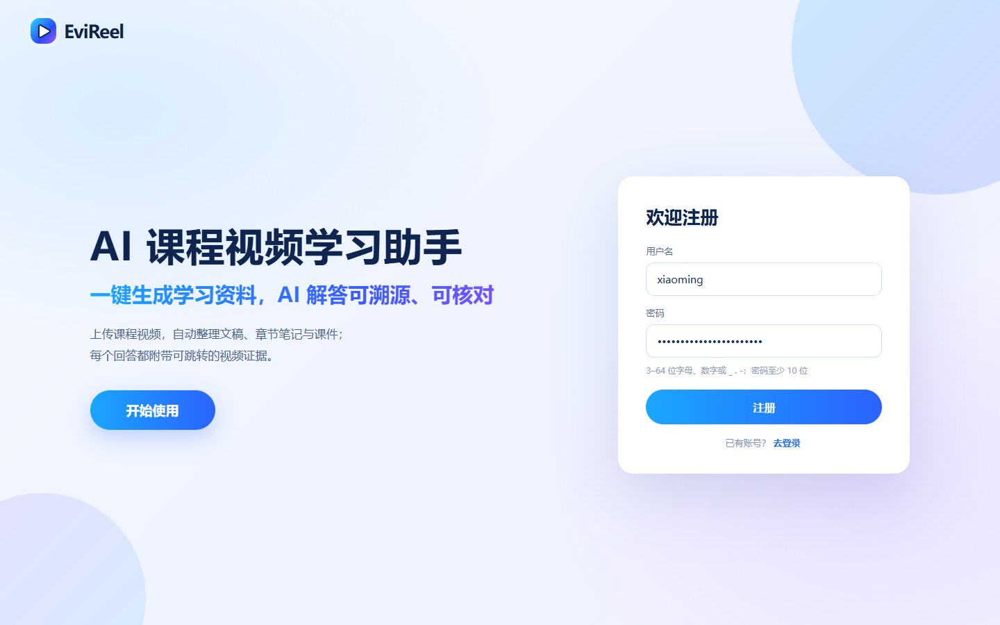
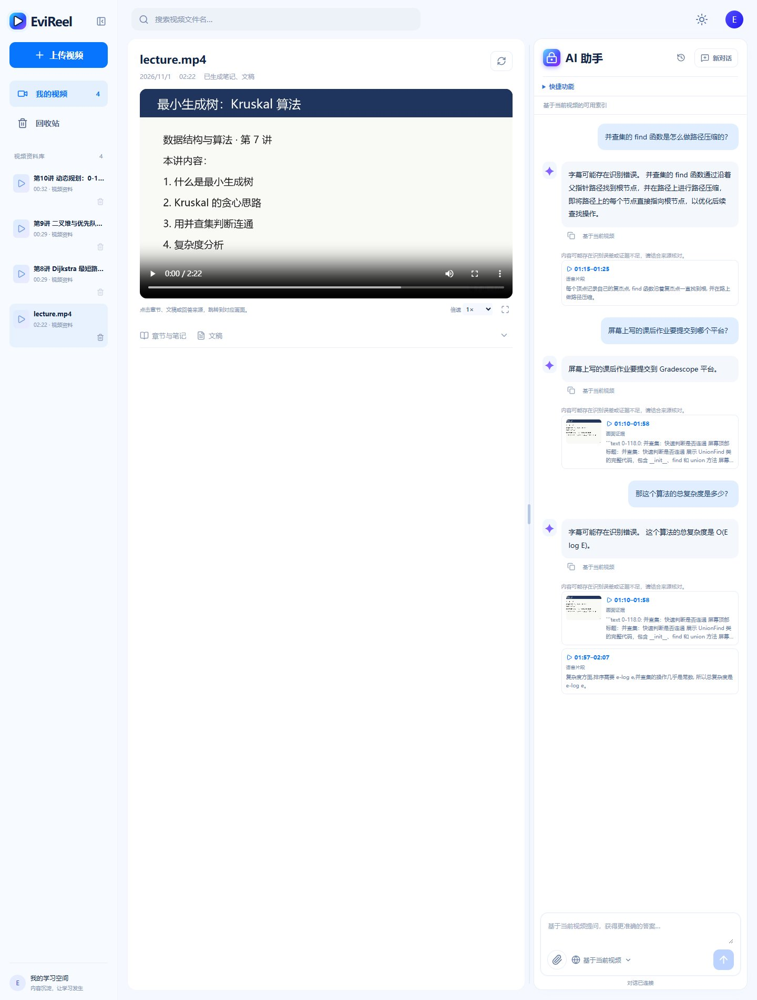
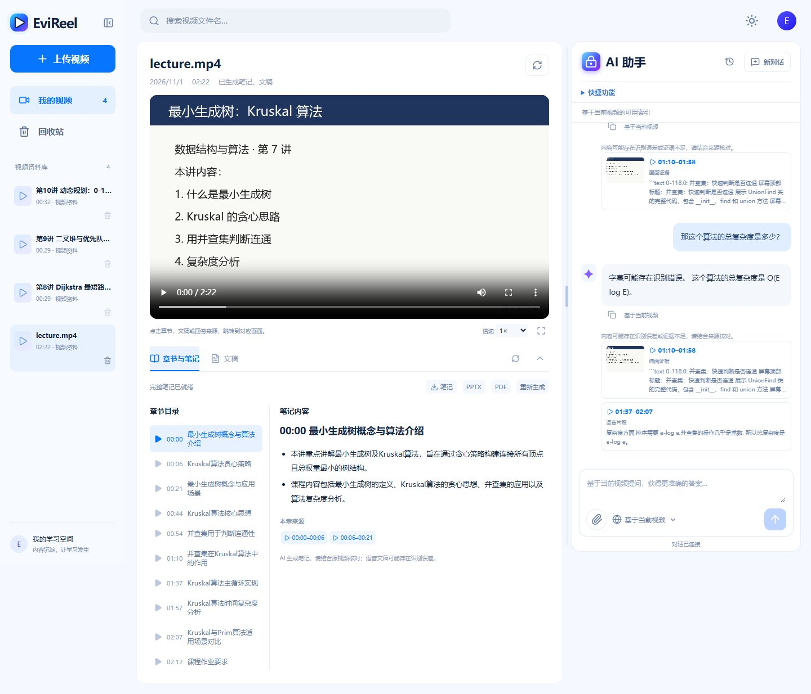
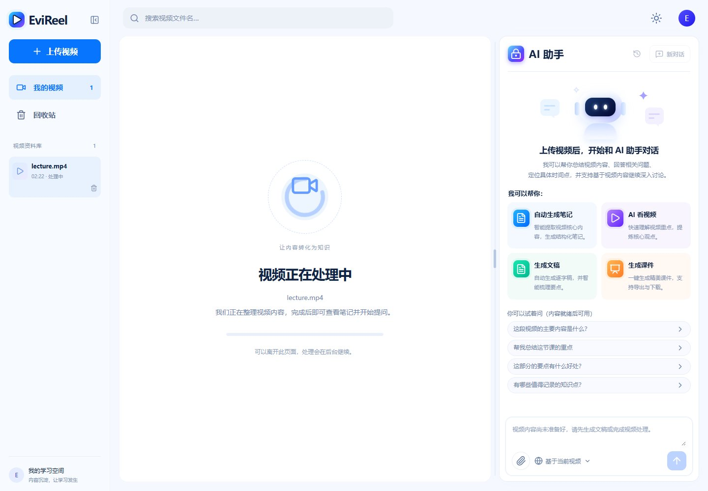
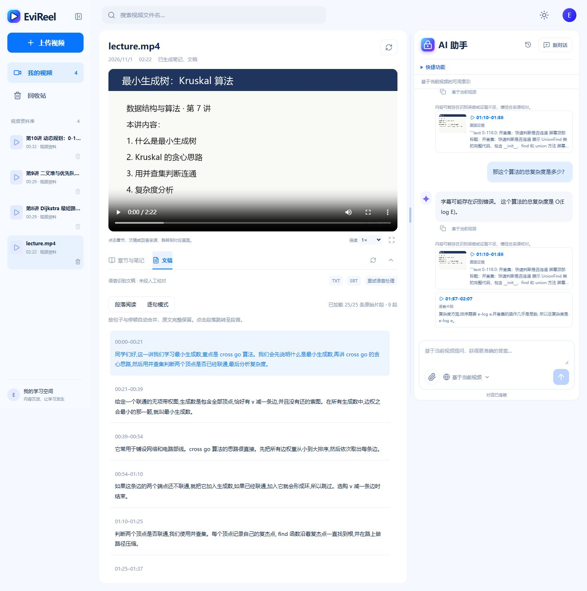
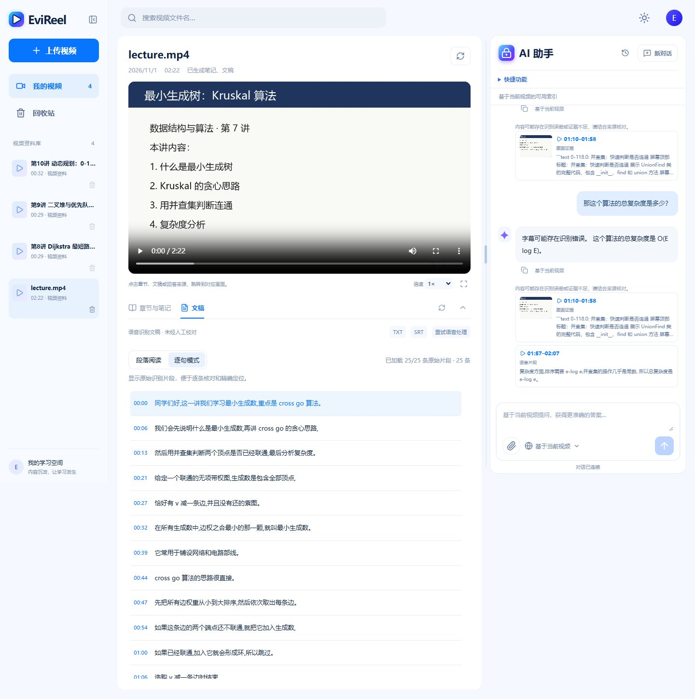
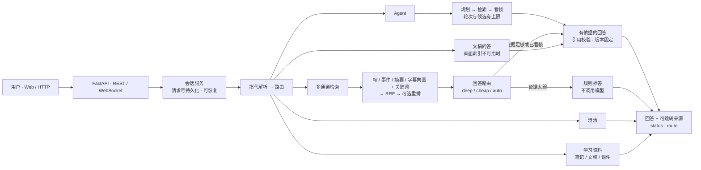

<div align="center">
  <h2>EviReel</h2>

  <p>
    
    
    
    
    
    
    
    
    <a href="./LICENSE"></a>
  </p>
</div>

<div align="center">

面向课程视频的**可溯源学习助手**。

把一段讲课视频变成可阅读的文稿、可定位的知识点和可导出的学习资料；<br>
每个 AI 回答都附带可点击跳转的视频证据，回到原片就能核对。

[项目预览](#项目预览) · [核心功能](#核心功能) · [系统流程](#系统流程) · [技术栈](#技术栈) · [本地运行](#本地运行)

</div>

## 项目预览

上传视频后，后台自动转写字幕、抽取并筛选画面、建立索引；在同一个工作区里播放视频、阅读章节笔记和文稿，并向 AI 助手提问。回答中的每条来源都可以点击，跳回对应的视频片段。

**注册与登录**：新用户在登录页即可注册，注册后自动创建自己的学习空间；视频、对话和上传会话按学习空间隔离，彼此不可见。



**带来源的问答**：第二个问题问的是只写在幻灯片上、讲解里没说的内容，回答引用的是画面证据；另外两个回答标注了“字幕可能存在识别错误”，因为对应的字幕确实有误识别（如把 O(E log E) 识别成 “e-log e”）。



**章节笔记**：由模型按字幕和画面分章生成，每章附来源时间，可导出 Markdown / PPTX / PDF。



<details>
<summary>查看处理中与文稿双模式</summary>

**视频处理中**



**文稿：段落阅读**



**文稿：逐句模式**



</details>

## 核心功能

课程视频的知识一半在**讲解**里、一半在**画面**上；学习者要的不是一段总结，而是“能找回、能核对”。EviReel 针对这类场景里的具体痛点，给出下面的解决方案。

### 🔍 长视频里找不到老师讲过的那一处

> 一节课一两个小时，复习时只能反复拖进度条；字幕搜索又漏掉写在幻灯片上的公式和代码。

- **分层视觉记忆**：抽帧并筛掉模糊、重复帧，帧聚合成事件、事件再生成摘要，三层都可检索，结果回溯到具体帧和时间。
- **多通道召回 + 融合**：画面帧、事件、摘要、字幕向量各自召回，用 RRF 按名次融合，可选重排；每条结果都是可点击跳转的时间点。
- **面向中文与代码的关键词通道**：向量检索对“并查集”“`uf.find`”这类精确词不敏感。中文按两字切分，代码符号既保留完整写法又拆成各部分，BM25 打分后参与融合。

### 🧾 AI 的回答不知道真假，也可能说的是幻灯片上根本没有的东西

> 没有来源的总结无法核对；模型还可能引用已经被替换的旧索引，或把字幕里没有的画面内容当成“看到了”。

- **证据约束的回答**：每次请求固定一组索引版本，回答只能引用本次检索登记过的证据；程序校验视频、版本和时间，引用旧版本证据会被拒绝。
- **看帧核验**：问题涉及画面时，由视觉模型读取相关帧再回答。截图中的第二个问题（作业提交平台只写在幻灯片上）就是靠读帧答对的。
- **状态由规则判定**：画面问题只有在画面真的被读到、且引用了读到的证据时才算“已回答”；读取失败、超时或没有可用帧时标为“不确定”并写明原因，不只听模型自报。

### 💸 每个问题都让视觉模型看帧，又慢又贵

> 大部分问题只看字幕就能回答，但“省钱版”可能答错，或在该拒答时乱答。

- **三种回答路径**：`deep` 总是先看帧；`cheap` 只用检索证据；`auto` 按明确规则选择，证据太弱且与画面无关时直接拒答、不调用模型。
- **有界升级**：`auto` 最多升级一轮，看帧数和升级时间都有上限；每个回答记录 `status` 与 `route`，能说清每一笔调用花在哪里。

### 📶 大视频上传断网就得重来，处理到一半服务重启也白做

> 课程视频动辄几个 GB；转写、抽帧、向量化又是几分钟到几十分钟的长任务。

- **可续传分片直传（E1）**：浏览器把分片直接传到对象存储，PostgreSQL 记账；续传前用 ListParts 对账并逐片校验 MD5，不会把两份文件的分片拼在一起。
- **可靠流水线（E2）**：任务受理和待发布消息写在同一个事务里（Outbox），再投递到 RabbitMQ；每次执行持有带租约的 attempt token，Worker 被 `kill -9` 后由别人接手，旧执行者的结果写不回去；分阶段检查点让重试从断点继续。14 个真实中间件故障测试在 CI 中运行。
- **可恢复的对话**：每个问题带请求号，服务端先持久化再执行、先保存结果再推送；刷新页面或断网后按同一请求号恢复，不会重复调用模型。

### 👥 热门课程多人同时提问，系统被一把锁卡住

> 压测发现瓶颈是“每个视频一把锁”：同一视频的问题只能排队，索引更新时还会阻塞读者。

- **版本快照 + 跨实例读租约（E3）**：读请求固定在某一代索引上并行读取，新版本发布不阻塞读者；旧版本等租约排空后才回收，回收认领与清理分离，并发清扫只执行一次。
- **共享的模型限流与用量账本**：所有模型调用经过统一网关，Redis 放限流窗口，PostgreSQL 记录每次调用并按工作区执行每日预算。
- 同一视频 20 并发时 P95 从 17.9 s 降到 2.4 s（本机单实例压测，模型调用为模拟器，不是真实供应商性能）；两个 API 实例经 nginx 轮询，停掉一个后 20/20 请求成功。

### 📏 “感觉回答变好了”无法证明

> 改检索或路由之前，需要一把能重复使用的尺子。

- **可重跑的评测工具（E4）**：题集分五类、分调参集与保留集；指标写明分母；每次运行记录代码版本、数据哈希、模型身份与计价依据；配置一次只改一件事，包括多轮 Agent 对照。路由规则曾因评测结果改过一次。
- 目前只在合成题集和确定性模拟器上验证了工具和规则，真实视频、人工标注、真实模型效果和费用尚未评测，见 [EVALUATION.md](docs/engineering/EVALUATION.md)。

## 系统流程



视频上传后的处理流水线：分片直传对象存储 → 事务 Outbox 投递任务 → Worker 分阶段执行（抽帧筛选 → 帧向量 → 事件与摘要；ASR → 字幕块与向量）→ 发布新一代索引，读者持有租约不受影响。

## 技术栈

| 层次 | 关键技术 | 核心用途 |
| :--- | :--- | :--- |
| 前端 | React 19、TypeScript、Vite | 视频工作区、文稿阅读、带来源的聊天、可续传上传 |
| API | FastAPI、Pydantic、WebSocket | REST 接口、实时事件、平台鉴权 |
| 异步处理和缓存 | RabbitMQ、Celery、Redis | 可靠处理流水线；共享限流、查询缓存、跨实例通知 |
| 数据与存储 | PostgreSQL、MinIO / S3、SQLite | 读模型、任务与租约、用量账本；视频与索引文件 |
| 视频语言和 AI | FFmpeg、faster-whisper、Qwen3-VL（OpenAI 兼容接口） | 抽帧与音频、语音转写、多模态向量、视觉核验与回答 |
| 部署 | Docker Compose、nginx、GitHub Actions | 中间件与多实例编排、四条 CI 流水线 |

## 本地运行

### 环境要求

| 组件 | 要求 | 说明 |
| :--- | :--- | :--- |
| Python | 3.10+ | 后端 |
| FFmpeg / FFprobe | 可在终端调用，或在 `.env` 中配置路径 | 抽帧与音频提取 |
| 模型服务 | 一个 OpenAI 兼容的 API key | 默认 SiliconFlow；不配置时只能播放和转写 |
| Docker Compose v2 | 平台模式需要 | 启动 PostgreSQL、MinIO、Redis、RabbitMQ |

### 单机模式

不需要任何中间件，数据保存在本地 SQLite 与文件中。

```bash
python -m venv .venv
source .venv/bin/activate            # Windows: .venv\Scripts\activate
pip install -e ".[asr]"              # 不需要语音转写可去掉 [asr]
cp .env.example .env                 # 填入 SILICONFLOW_API_KEY，按需调整模型
vam-server                           # 浏览器打开 http://127.0.0.1:8000/app/
```

语音模型默认不自动下载（`ASR_LOCAL_FILES_ONLY=true`），需先把 faster-whisper 模型放进 `ASR_MODEL_CACHE`。

### 平台模式

完整中间件、两个 API 实例经 nginx 轮询，以及按队列拆分的 Worker（Linux 或 WSL2）：

```bash
cp deploy/e1/dev.env.example deploy/e1/dev.env      # 改成自己的开发口令
cat deploy/e2/dev.env.example >> deploy/e1/dev.env
docker compose --env-file deploy/e1/dev.env -f deploy/e3/compose.yml up -d --build --wait
docker compose --env-file deploy/e1/dev.env -f deploy/e3/compose.yml exec api-1 \
  sh -c 'EVIREEL_NEW_PASSWORD=<口令> python -m vam.platform.migrate create-user --username demo'
```

浏览器打开 `http://127.0.0.1:8000/app/`，在登录页注册新账号，或用上面创建的账号登录（设置 `AUTH_ALLOW_REGISTRATION=false` 可关闭自助注册）。

## 当前边界

- 问答范围是“当前视频”，不支持跨视频检索或联网搜索。
- 平台模式的 API 与 Worker 共享一个数据卷，是单机部署；没有做多机部署与双实例吞吐实测。
- 语音识别和模型总结都可能出错；引用校验保证来源真实存在，不保证结论正确，重要内容请回原视频核对。

## License

本项目基于 [MIT License](LICENSE) 开源，视频在线索引（抽帧筛选、帧向量与事件分段）、分层视觉记忆与 Agentic 检索功能部分代码引用至：[yiliu-li/Visual-Agentic-Memory](https://github.com/yiliu-li/Visual-Agentic-Memory)（MIT License）。
