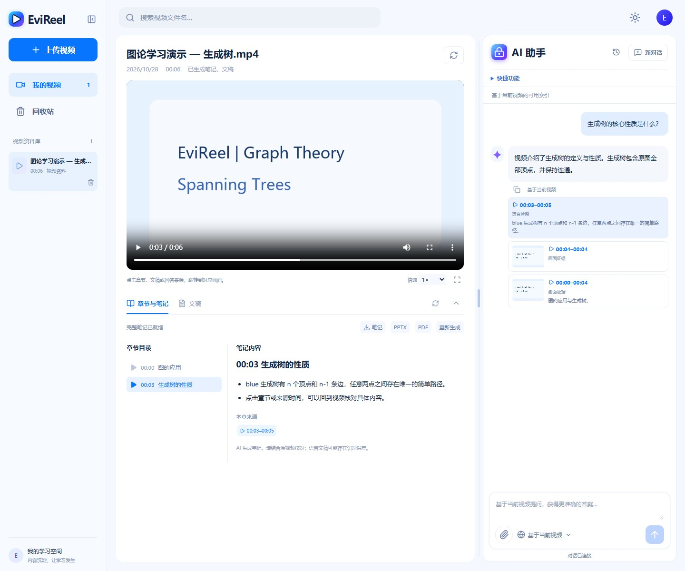
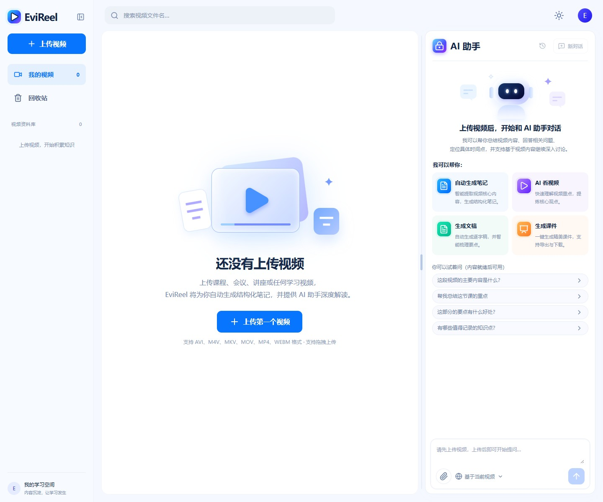
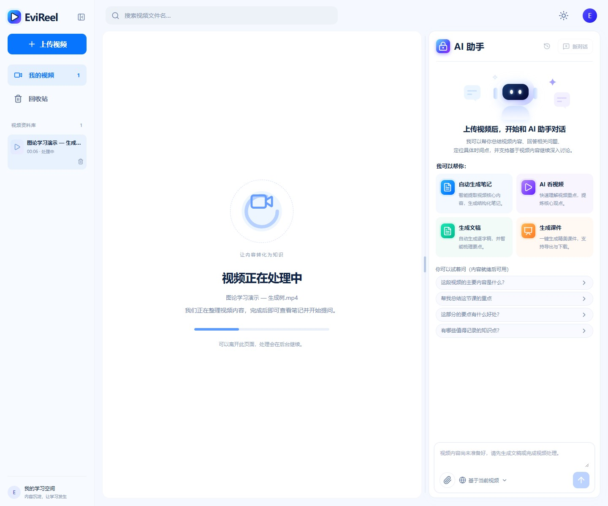
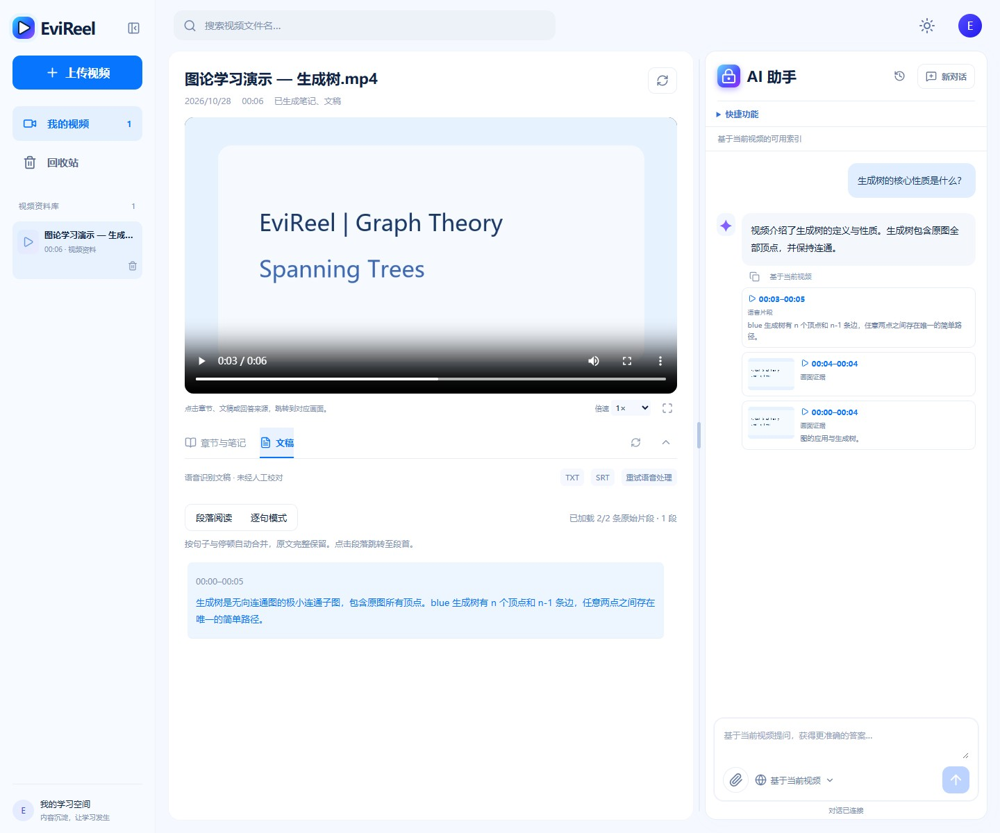
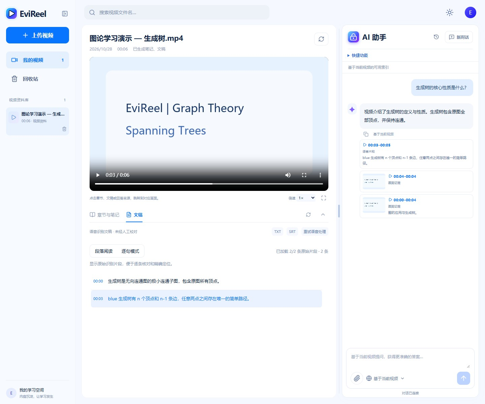
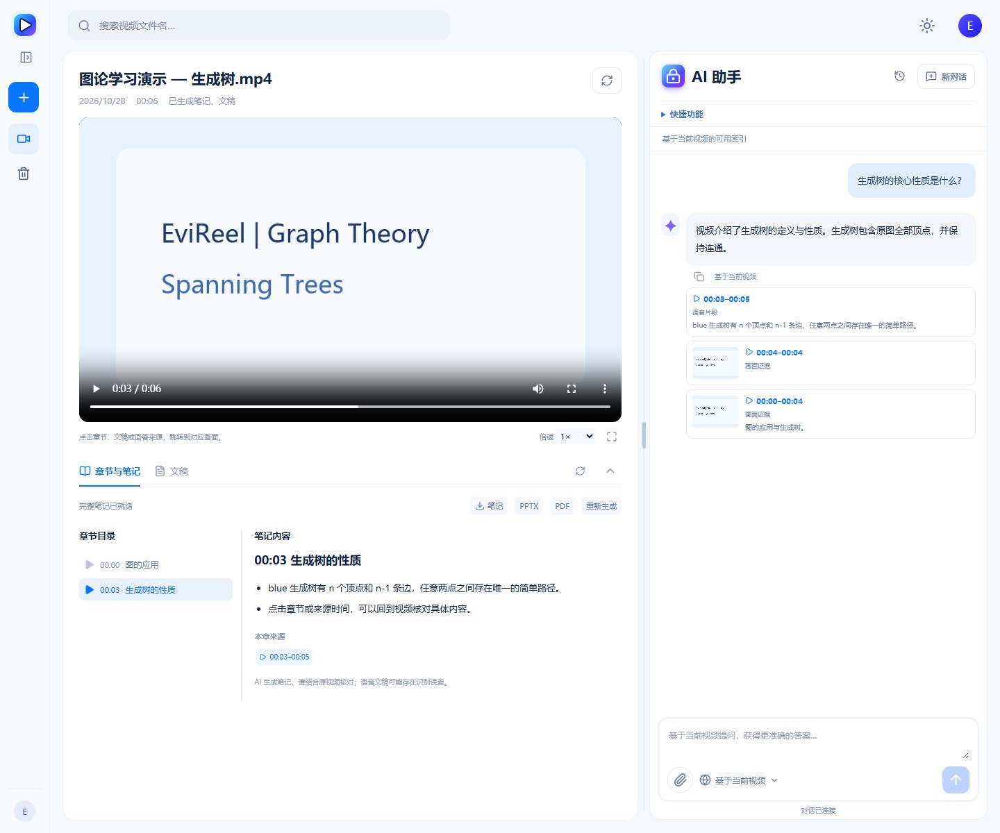
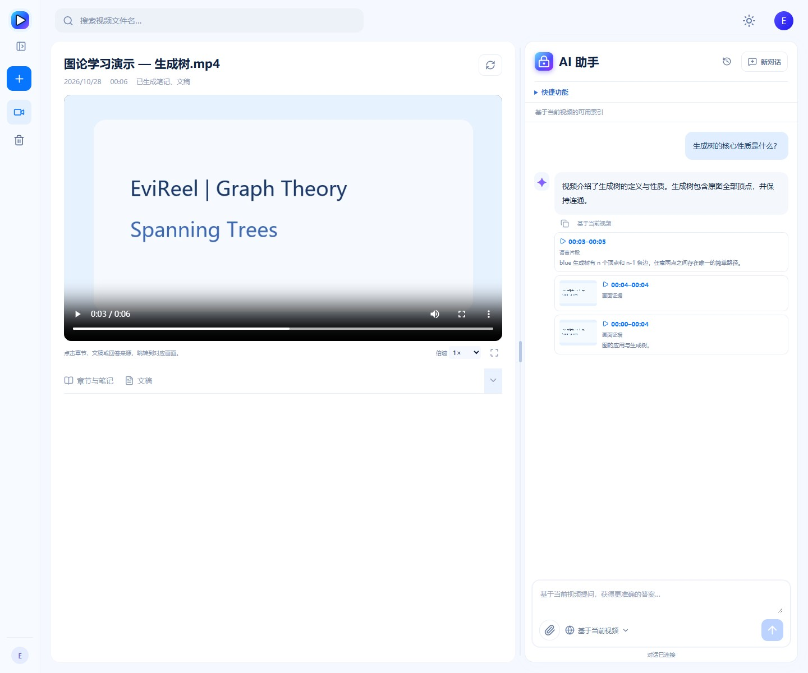
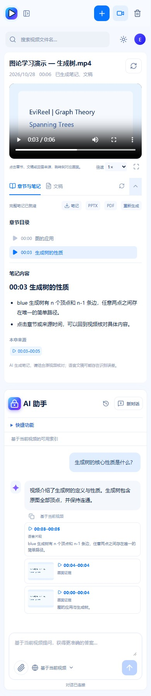
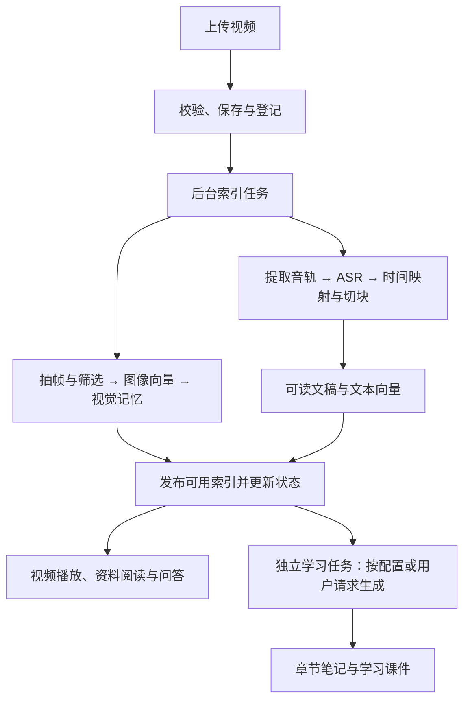

# EviReel

**基于分层多模态记忆与 Agentic RAG 的可溯源视频学习助手。**

将课程、讲座和演示视频整理成可阅读的文稿、可定位的知识点与可导出的学习资料。围绕当前视频提问，在回答中查看来源，再跳回对应片段核对。

[示例展示](#示例展示) · [设计背景](#设计背景) · [功能介绍](#功能介绍) · [技术栈](#技术栈) · [工作流程](#工作流程)

## 示例展示

### 网页学习工作区

在同一页面播放视频、阅读章节笔记，并向 AI 助手提问。右侧来源卡片可点击跳转，核对对应视频片段。

> 本节 8 张截图均于 **2026-10-28** 从当前版本重新构建、运行并操作网页后截取，展示可调宽度、侧栏折叠、学习区收起和文稿双模式等现有功能。演示采用合成视频与显式测试模型，验证操作流程，不代表真实课程的模型效果。详见 [本次网页测试记录](docs/README_WEB_TEST_20261028.md)。

查看上传、处理、文稿双模式、收起布局与手机页面

**上传前**

**视频处理中**

**文稿：段落阅读**

默认合并为便于阅读的自然段，保留原文及来源时间。

**文稿：逐句模式**

切回原始识别片段，点击时间定位并核对；仍可下载 TXT / SRT。

**侧栏折叠与两栏比例调整**

**笔记与文稿收起**

**手机布局**

### 典型学习场景

以下是提问与操作示例，不是预先录制的真实模型答案；实际结果取决于视频材料和可用索引。

| 学习目标 | 可以怎样操作 | 查看什么 |
| --- | --- | --- |
| 找到一个知识点 | 问“老师在哪里介绍了生成树的性质？” | 相关回答、来源片段和可跳转时间 |
| 核对画面与讲解 | 问“这张图怎样说明生成树的性质？” | 有视觉能力时的画面核验；仅文稿模式会明确标注 |
| 理解当前内容 | 选中章节或定位播放位置，再问“这部分主要在讲什么？” | 对应范围内的说明与来源；范围不明时先澄清 |
| 连续追问 | 接着问“这个概念后面举了什么例子？” | 结合历史解析指代，再查找相关材料 |
| 整理复习资料 | 使用笔记或课件入口 | 任务状态、章节预览及 Markdown / PPTX / PDF 下载 |
| 阅读与校对文稿 | 在段落阅读和逐句模式间切换 | 同一份识别原文及片段时间；可下载 TXT / SRT |

### 进一步了解

- [部署与学习接口](docs/P5_DEPLOYMENT.md)：启动网页、运行配置、学习任务与导出。
- [视频管理 API](docs/P1_VIDEO_API.md) · [语音与字幕](docs/P2_TRANSCRIPT_API.md)
- [检索与证据](docs/P3_SEARCH_API.md) · [持久会话协议](docs/P4_CONVERSATION_API.md)
- [聊天与快捷入口实现记录](docs/CHAT_ACTIONS_DELIVERY.md) · [文稿阅读实现记录](docs/TRANSCRIPT_READING_DELIVERY.md)

## 设计背景

长视频承载了大量知识，但“看过”并不等于“能快速找回”。复习一段课程时，学习者往往需要反复拖动进度条，寻找老师讲过的定义、例子或推导过程；整理文稿和笔记又会消耗额外时间。

视频信息还分布在不同通道中：语音解释概念，画面呈现公式、图表和操作步骤。仅搜索字幕可能遗漏视觉细节，仅概括画面又可能失去讲解中的条件与因果关系。没有来源的 AI 总结，则难以判断是否忠实于原视频。

EviReel 围绕这三个问题设计：

- **让内容可查找**：预先处理视频，建立带时间信息的画面与语音记录，减少反复浏览全片的成本。
- **让回答可核对**：将回答关联到视频证据，支持回到原片检查，而不是只提供一段无法追溯的文字。
- **让知识可复用**：把视频内容整理成章节笔记、文稿和学习课件，支持阅读、复习与导出。

项目沿用 Visual Agentic Memory（VAM）的分层视觉记忆与检索能力，并提供面向视频学习的网页工作区。

## 功能介绍

### 视频资料管理与播放

- 上传视频，查看上传进度、后台处理状态，并在失败后重试。
- 管理多个视频，按文件名搜索；通过回收站恢复或永久删除资料。
- 在浏览器中播放视频，支持倍速、全屏，以及从章节、文稿和回答来源跳转到对应时间。
- 每个视频拥有独立的索引与会话范围，切换视频时隔离返回结果。

### 文稿阅读与章节笔记

- 从音轨生成带片段级时间信息的语音文稿，支持 TXT、SRT 导出。
- 文稿默认按自然段阅读，也可切换为原始识别片段；阅读与播放位置联动。
- 根据可用语音文稿或视觉事件文字生成章节标题、知识点和来源定位。
- 支持 Markdown 笔记及 PPTX、PDF 学习课件导出；已有有效资料可复用。
- 资料生成由后台任务执行，显示进度与失败状态；来源更新后，旧资料会标记为过期。

### 带来源的 AI 问答

- 围绕当前视频提问，结合画面帧、事件、摘要和语音文稿查找相关内容。
- Agent 可根据中间结果继续搜索或核验画面，处理需要多步定位的问题。
- 回答附带经过程序校验的来源信息，点击有效来源可回看视频。
- 支持连续追问、历史会话与指代解析；指代不明确时请求澄清。
- 即使语义索引暂不可用，只要存在可读文稿，仍可使用文本问答路径；界面会标明“基于语音文稿 · 未分析画面”。

### 一体化学习工作区

- 视频播放、章节与文稿、AI 助手集中在同一页面。
- 提供 AI 看视频、笔记、文稿、课件快捷入口，以及推荐问题。
- 资源卡片支持查看、下载和生成状态恢复。
- 学习区与助手之间可拖动调整宽度，侧栏及学习内容可收起，适配桌面与手机。
- 对话请求与最终结果持久化，支持刷新、断线后的状态查询和结果恢复。

> 当前产品面向单工作区、当前视频学习，不包含账号权限体系、跨视频问答或联网搜索。语音识别与模型总结可能存在误差，引用校验也不等于事实正确性保证；重要内容应结合原视频核对。

## 技术栈

| 层级 | 技术与实现 | 在产品中的作用 |
| --- | --- | --- |
| 网页前端 | React、TypeScript、Vite、原生 CSS、Lucide React | 视频工作区、资料阅读、聊天、响应式布局与交互 |
| 后端服务 | Python 3.10+、FastAPI、Uvicorn、Pydantic | HTTP API、WebSocket 事件、输入校验和业务服务 |
| 媒体处理 | FFmpeg / FFprobe、OpenCV、Pillow、scikit-image | 媒体检查、播放预处理、抽帧、图像筛选与音频提取 |
| 语音识别 | faster-whisper，可选 ASR 依赖 | 本地语音转写、时间映射与字幕切块；默认 CPU / INT8 配置 |
| 多模态模型 | OpenAI 兼容接口；SiliconFlow / OpenRouter 适配 | 问题路由、视觉核验、答案与学习资料生成 |
| 向量表示 | 多模态 Embedding、PyTorch | 将画面与文字转换为可比较的向量 |
| 检索与回答 | Frame / Event / Summary / Transcript、多路召回、RRF、可选 Cohere Rerank | 汇集证据、融合排序、可选文本重排与来源约束回答 |
| 持久化 | SQLite 与本地文件系统 | 视频元数据、任务、会话、字幕、向量及生成资料 |
| 后台执行 | asyncio Task、并发限制、持久化任务状态 | 索引、问答和学习资料生成的异步执行与状态恢复 |
| 文档导出 | python-pptx、ReportLab | PPTX 课件与 PDF 导出 |
| 工程验证 | pytest、Vitest、Playwright、GitHub Actions | 后端、前端与浏览器流程验证 |

当前向量检索由 SQLite 保存数据，应用层计算相似度；未使用独立向量数据库。后台执行仍由单服务进程管理，持久化状态用于恢复记录与结果，服务重启后不会自动续跑模型计算。

模型与运行参数可配置，具体以 [配置示例](.env.example) 和 [配置代码](vam/config.py) 为准。生产部署使用单 worker；部署方式见 [部署与学习接口文档](docs/P5_DEPLOYMENT.md)。

## 工作流程

### 1. 上传视频，建立可检索资料

1. **接收与校验**：后端接收文件，检查格式、大小与媒体信息，保存原片并登记视频。
2. **创建后台任务**：返回视频与任务标识，网页持续展示处理状态。
3. **构建视觉索引**：抽取画面，筛除模糊或冗余帧，生成图像向量，组织帧与事件等视觉记忆。
4. **构建语音资料**：提取音轨，执行 ASR，将时间映射到视频，再整理片段、文本块与文本向量。
5. **发布可用结果**：记录各项能力的就绪情况；字幕可读与字幕语义搜索可用是两个独立状态。无音轨时跳过语音处理。
6. **生成学习资料**：配置模型并启用自动生成时，启动独立学习任务；也可通过快捷入口请求生成。

### 2. 提问，查证，再回到原视频

1. 选择视频并发送问题；会话服务保存请求，整理历史上下文，必要时解析“刚才那个”“这部分”等指代。
2. 根据当前能力和请求范围选择路径：可用索引支持多模态检索；可读文稿支持文本问答；资料类快捷入口交给学习任务处理。
3. 在检索路径中，Agent 选择查询与核验动作；候选结果经过融合及可选重排，必要时检查画面。
4. 基于本次允许使用的来源生成回答，校验引用身份与时间信息；证据不足时给出提示。
5. 最终结果先保存，再发送给客户端。用户可查看来源卡片，并跳回相应视频片段。

普通 HTTP 检索也可以直接使用检索管线，无需经过 Agent。系统不会把所有问答都强制变成同一条多轮流程。

### 3. 整理与导出

学习任务读取可用材料，分批生成章节和知识点，经来源校验后发布成品。用户可以阅读笔记，下载 Markdown、PPTX 或 PDF；语音文稿可单独下载 TXT 或 SRT。

学习课件由已生成笔记组织而成，不是对原视频 PPT 的自动还原。生成失败会保留此前成功的成品；索引或来源更新后，旧资料会标记为过期，可重新生成。

---

EviReel 基于 VAM 框架演进，保留终端工具与 API 入口。项目采用 [MIT License](LICENSE)。
