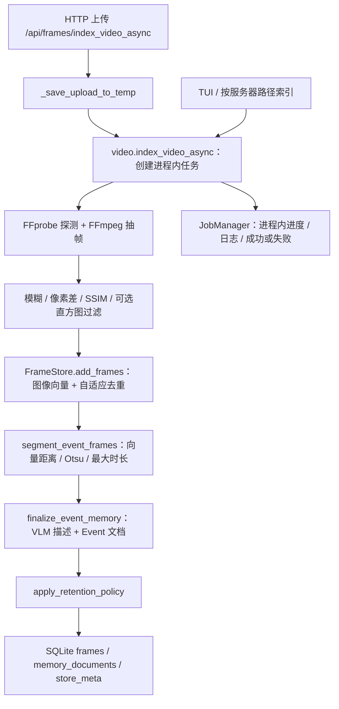
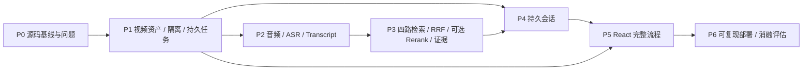

# VideoMemory Agent V2：P0 源码审查与 Baseline 报告

日期：2026-10-16（Asia/Shanghai）  
目标仓库：[xiaohuali280-star/VAM](https://github.com/xiaohuali280-star/VAM)  
审查基线：`4f759407945674e0b296ecee22bd53cf910ae39b`（`main`）  
范围：仅 P0。未实现 P1–P6，未修改 `vam/` 核心源码。

**1. 本阶段目标**

核实原 VAM 的真实能力、扩展入口、数据生命周期和测试边界，形成可执行的 P1 清单。

仓库与环境核验：

| 项目 | 核验结果 |
| --- | --- |
| 账号与授权 | 已连接账号拥有目标 Fork 的 pull / push / maintain / admin 权限 |
| Fork 来源 | GitHub 仓库元数据确认 parent 为 `yiliu-li/Visual-Agentic-Memory` |
| 目标选择 | 用户明确确认使用 `xiaohuali280-star/VAM`；没有修改 VideoStudyAgent 或原作者仓库 |
| 起始远程分支 | 仅发现 `main`，指向上述提交；API 返回 protected=false |
| 当前聊天环境 | Codex Desktop，本地工作目录无源码、无 Git 仓库；实际执行 `git status --short --branch` 返回退出码 1：not a git repository |
| 云端执行方式 | 本聊天没有可调用的 Codex Cloud 交互式终端；通过 GitHub 连接器读取源码，在 GitHub Actions 的 Ubuntu runner 执行测试 |
| 工作区状态限制 | 不能把远程分支状态当作交互式 Cloud 工作区的 `git status`；未获得此类工作区的未提交变更信息 |
| P0 提交方式 | 独立分支 `codex/p0-source-audit-baseline`；不合并主分支 |
| 起始测试设施 | `tests/test_image_limits.py` 中 3 个 unittest；没有 workflow 文件，Actions 历史 total_count=0 |

真实文件布局：根目录有 README、MIT LICENSE、`.env.example`、`pyproject.toml`、`setup.cfg`、`setup.py`、`run.py`、`tui.py`；`vam/` 包含 video、agent、jobs、config、protocol、prompts，以及 retrieval、vision、llm、server、memory、user 子包。起始树共有 43 个文件，GitHub 返回 truncated=false。没有 package.json、React/Vite 前端目录、ASR 包、视频样本或 Docker/CI 配置。这里的“没有”指本次固定提交的完整树。

[仓库依赖配置](https://github.com/xiaohuali280-star/VAM/blob/4f759407945674e0b296ecee22bd53cf910ae39b/pyproject.toml) 要求 Python >=3.10，已有 FastAPI、uvicorn、pydantic、pydantic-settings、httpx、multipart、torch、Pillow、scikit-image、opencv-python、numpy、rich。Python 3.11 对应 numpy<2，opencv-python<4.11。未声明 faster-whisper、向量数据库、Redis、Celery、LangChain 或 LangGraph；依赖没有完整版本锁定。`.env.example` 已存在，P6 应扩充而不是重复创建。

**2. 修改文件**

| 文件 | 操作与用途 |
| --- | --- |
| `tests/test_p0_baseline.py` | 新增 12 项 P0 测试：SQLite 隔离/重载、维度校验、时间分层、Event/Summary、检索过滤、Mock Planner、WebSocket、真实 FFmpeg；包含两项用于揭示上游缺陷的契约测试 |
| `.github/workflows/p0-baseline.yml` | 新增 Ubuntu/Python 3.11/CPU 测试流程，不配置模型密钥；仅 P0 分支相关源码、测试和 workflow 变化触发 |
| `docs/P0_SOURCE_AUDIT.md` | 新增本审查报告及 P1 开发清单 |

原有核心实现、依赖清单、README、`.env.example` 和原有 3 项测试均未修改。测试内的 Mock 只用于测试，不属于产品实现。

**3. 核心实现：真实调用链与复用判断**

视频索引调用关系：



- 上传入口：[frames.py:105](https://github.com/xiaohuali280-star/VAM/blob/4f759407945674e0b296ecee22bd53cf910ae39b/vam/server/api/frames.py#L105)。上传按 8 MiB 块写临时文件，返回 job_id。随后 `cleanup_temp=True`，任务 finally 删除上传的原视频临时文件。原视频没有作为业务资产持久化。
- 核心编排：[video.py:356](https://github.com/xiaohuali280-star/VAM/blob/4f759407945674e0b296ecee22bd53cf910ae39b/vam/video.py#L356)。`asyncio.create_task` 创建任务，抽帧在工作线程中执行；不是 Celery 队列。
- 抽帧：[extract_data_uris_ffmpeg](https://github.com/xiaohuali280-star/VAM/blob/4f759407945674e0b296ecee22bd53cf910ae39b/vam/video.py#L136) 依赖 ffmpeg、ffprobe、OpenCV、numpy、scikit-image。默认 0.5 FPS，采样时间按 idx/fps 生成名义相对秒数，并非逐帧读取原始 PTS；真实课程的定位偏差尚未测量。可叠加 `video_absolute_start_time`。抽帧和选择结果会缓存于临时目录；最终返回整批 Base64 图像列表，长视频的磁盘和内存成本需要测量。
- 图像向量与去重：[add_frames](https://github.com/xiaohuali280-star/VAM/blob/4f759407945674e0b296ecee22bd53cf910ae39b/vam/retrieval/frame_store.py#L1117) 校验输入长度和向量维度，批量写入、跳过已有 frame_id，按余弦距离与自适应阈值去重，尽量保留相似段的边缘帧。
- 事件切分：[segment_event_frames](https://github.com/xiaohuali280-star/VAM/blob/4f759407945674e0b296ecee22bd53cf910ae39b/vam/retrieval/frame_store.py#L1024) 与邻帧向量距离、阈值计算和时长上限有关；默认事件最长 300 秒。不是语音或课程章节检测。
- 事件生成默认开启，可通过 `VAM_ENABLE_EVENT_FINALIZE=0` 关闭。VLM 输入可包含前最多 8 张帧图和 FFmpeg 裁出的片段；事件描述异常会影响整个索引任务。不要将所有事件 API 失败理解成可自动跳过。
- [JobManager](https://github.com/xiaohuali280-star/VAM/blob/4f759407945674e0b296ecee22bd53cf910ae39b/vam/jobs.py#L26) 已有 queued/running/done/error、phase、current/total、日志和 task 引用，但都在内存字典里，重启丢失；当前 app 没有挂载 HTTP 任务查询路由。
- 默认 frame_id 是 `v-000001` 等，与 video_id 无关。不同视频写同一默认库时会跳过同名帧或混入不同内容。传入不同 store_path 的库级隔离能力可复用，但业务端到端隔离尚不存在。

时间分层与语义粒度必须分开：

| 机制 | 真实实现 | 结论 |
| --- | --- | --- |
| Frame 时间保留 | `FrameRecord.memory_tier`；`apply_retention_policy` | recent/mid/long 根据视频时间轴上最新帧与当前帧的差值计算 |
| Event 语义文档 | `MemoryDocument(layer="long", kind="event")` | long 是现有文档标记，不能据此判断视频已经过去 24 小时 |
| Summary 语义文档 | `MemoryDocument(layer="summary", kind="summary")` | 由 summarize 请求按窗口创建/更新；上传链路不自动创建 |
| Transcript | 未实现 | 应是独立来源，按 video_id 和时间范围关联视觉证据 |

[保留规则](https://github.com/xiaohuali280-star/VAM/blob/4f759407945674e0b296ecee22bd53cf910ae39b/vam/retrieval/frame_store.py#L1485) 的时间轴通常为相对时间；至少两帧带 absolute_t 时使用绝对轴。age=`latest_t - frame_t`，不使用数据库插入时间、上传时间或当前墙钟。默认 recent <=3600 秒，mid <=86400 秒，其余 long。最小采样间隔分别为 1、20、120 秒；mid 压缩到最长边 768、JPEG 70，long 为 512、JPEG 45；首尾帧及现有 event/long 代表帧有特殊保留规则。两帧及以下直接返回，不重新计算层级。

需要特别注意：`finalize_event_memory` 先把事件帧标为 mid、末帧标为 long；随后 retention 又按时间轴计算。这是源码中的标签复用和调用顺序，不能简化为“60 分钟视频一定在 SQLite 中全部是 recent”。P0 专门检测了仅标签变更是否持久化，结果见测试和问题部分。另有缺失 re 导入阻断 Event/Summary 的现存缺陷；因此本节描述的是源码调用设计，不表示这些流程已经正常运行通过。

[Summary 实现](https://github.com/xiaohuali280-star/VAM/blob/4f759407945674e0b296ecee22bd53cf910ae39b/vam/retrieval/frame_store.py#L2104) 通过 `summarize_time_range` 按至少 5 秒的窗口取 Frame/Event，调用 `describe_summary_window`，再 `upsert_summary_document`；同一窗口、结构、粒度和 focus 可更新已有文档。VLM 失败可使用现有事件/帧信息形成回退文本，回退文本不等价于真实 VLM 摘要。顶层 summarize 工具和内部 Planner summarize 动作都可调用此功能。

Embedding 与 SQLite：

| 项目 | 已核实事实 |
| --- | --- |
| Backend 接口 | `VisionBackend` 同时声明文本/图像、单条/批量接口 |
| 实际类名 | `OpenRouterGeminiBackend` 为历史命名，当前 name 固定为 siliconflow-qwen；不能据类名断言实际使用 Gemini 或 OpenRouter |
| 默认 Embedding 模型 | `Qwen/Qwen3-VL-Embedding-8B` |
| 默认回答/VLM 模型 | `Qwen/Qwen3-VL-8B-Instruct` |
| 默认端点 | `https://api.siliconflow.cn/v1/embeddings` 与 `/chat/completions` |
| 服务选择 | Settings 按 DashScope key、SiliconFlow key、OpenRouter key 的顺序选择 provider；目前聊天和 Embedding 共享 provider/base URL/API key，不能直接通过现有设置完全独立选择两个服务商 |
| 文本 Embedding 请求 | `input: [text,...]`；query/document 通过 instruction 中是否有 query 来选 input_type |
| 图像 Embedding 请求 | `input: [{content: [{type: image_url, image_url: {url: dataURI}}]}]`，发送前压缩图片 |
| dimensions | 配置为正数才发送；默认 0，不硬编码实际输出维度 |
| SQLite | WAL；frames 保存图像和 FP16 向量 BLOB，memory_documents 保存文本、时间范围、帧关联和向量，store_meta 保存维度、backend 名称、revision 等 |
| 检索计算 | SQLite 过滤时间/类型，PyTorch 在进程内计算余弦相似度；不是 SQLite 向量索引或外部向量数据库 |
| 持久化并发 | `BEGIN IMMEDIATE` + revision 检查；写入会替换整份 frames/documents 快照，不能假设支持任意并发写入 |
| 模型一致性 | 批量帧有维度检查，但加载不校验完整 provider/model 指纹；相同维度的不同模型仍可能被混用 |
| Mock | 已有 DummyBackend 返回 128 维零向量，可做无网络接口检查，不适合检索质量验证；P0 使用非零确定性 Mock 验证检索流程 |

依据：[Settings](https://github.com/xiaohuali280-star/VAM/blob/4f759407945674e0b296ecee22bd53cf910ae39b/vam/config.py)、[Backend](https://github.com/xiaohuali280-star/VAM/blob/4f759407945674e0b296ecee22bd53cf910ae39b/vam/vision/backends.py)、[Embedding 请求](https://github.com/xiaohuali280-star/VAM/blob/4f759407945674e0b296ecee22bd53cf910ae39b/vam/llm/openrouter.py#L245)、[SQLite Schema](https://github.com/xiaohuali280-star/VAM/blob/4f759407945674e0b296ecee22bd53cf910ae39b/vam/retrieval/frame_store.py#L353)。这里确认的是代码实现的多模态调用接口和配置；没有密钥，尚未证明指定服务当前接受这些载荷或产生兼容的图文向量。单帧适配器的返回结构也需要按测试结果处理。

Agentic Retrieval 真实流程：

```text
/ws/agent 收到 text
  -> stream_agent_response
  -> route_text_request（只收到当前文本，JSON/Pydantic 校验）
     -> final / retrieve / summarize
  -> retrieve:
     resolve_memory_store（默认库）
     search_generator(question, store_instance, chat_history)
       -> Planner 读取任务、最近聊天、当前检索执行上下文、Summary 结构
       -> search / inspect / summarize / answer
       -> hybrid_event_frame_search
          Frame + long/event + summary/summary，支持 sources/时间范围
       -> inspect_frames / inspect_frame，或时间锚点候选视觉裁决
       -> 后续 Planner 回合
       -> answer + final（best、turns、duration_s）
  -> append_history（问题和回答文本）
```

主要入口：[agent.py](https://github.com/xiaohuali280-star/VAM/blob/4f759407945674e0b296ecee22bd53cf910ae39b/vam/agent.py)、[search_generator](https://github.com/xiaohuali280-star/VAM/blob/4f759407945674e0b296ecee22bd53cf910ae39b/vam/retrieval/agent_search.py#L784)、[Planner 协议](https://github.com/xiaohuali280-star/VAM/blob/4f759407945674e0b296ecee22bd53cf910ae39b/vam/protocol.py#L240)。默认最大 20 个 Planner 回合，输出异常有 JSON 重试及回退；有证据检查和结束回退，但证据检查并不自动证明回答正确，真实效果需要评估。

现有 Hybrid 检索已覆盖 Frame/Event/Summary，并有多查询并行、时间锚点、结果引用、联合视觉检查和 Summary 过滤。它按原始相似度合并排序，以 doc_id/frame_id 去重；文档分数取全文、chunk、field 匹配的最大值。**没有 RRF，也没有可单独开关和评估的 Reranker**。VLM inspect 属于证据检查，不应标成已实现可配置 Rerank。P3 应扩展此入口而不是另起整套 Agent。

现有返回协议未统一：文档结果 source=memory_document，结合 kind 区分 event/summary；帧结果只有点时间 t，文档有 time_range；部分结果中的 layer 是帧 memory_tier，部分是文档 layer；best 摘要会丢掉 doc_id 等信息，完整 turns 仍保留部分证据。P3 需要明确 source、video_id、doc_id/frame_id、起止时间与可空字段，不能仅直接复用 best 作为最终引用协议。

WebSocket 与 Conversation：

- [agent_chat](https://github.com/xiaohuali280-star/VAM/blob/4f759407945674e0b296ecee22bd53cf910ae39b/vam/server/ws/agent_chat.py#L29) 每次连接新建 history=[]，reset 清空，断开后没有恢复标识；不含 conversation_id/video_id。
- 内部 Planner 通过 `_build_chat_history_string` 取最后 **8 条消息**（典型为 4 轮），压平空白后放入 prompt；不是最近 8 轮。连接内 history 列表本身没有截断，也没有摘要压缩或 token 上限。
- 顶层 `route_text_request(*, transcript)` 不接收 history；因此内部检索能看到历史，不代表顶层选择工具和改写问题时能看到。对“这个公式”“上一段”的上下文使用不完整。
- history 只保存问题/回答文本，没有持久化上一轮证据 ID 或时间范围；检索 context 是一次 search_generator 的局部列表，不能当作 Conversation Memory。
- 有 `memory/session_memory.py` 和 `user/metadata_store.py`：具备用户对话摘要/习惯提取雏形，但 metadata_store 是内存字典，未接入当前 WebSocket 主链路，不是可直接交付的 SQLite 会话管理。
- 当前 WebSocket 推送 plan、search、inspection、answer、final 等执行事件。现有 chat 客户端最终读取完整 message；当前没有真正的逐 token 文本推送，前端不得假设收到 token delta。应先展示已存在的执行阶段事件。
- endpoint 不接受图像输入/运行时配置更新，也没有视频或会话切换协议。

可复用与新增边界：

| 可复用 | 需新增或扩展 |
| --- | --- |
| FFprobe/FFmpeg 抽帧与事件片段裁切 | 持久化原视频、播放格式处理、Range/跳转验证、文件生命周期 |
| FrameStore 与独立 persist_path | 服务端 VideoRegistry、受控 video_id->路径映射与删除流程 |
| 图像/文本 Embedding Backend | 模型指纹、维度/响应基数校验；P2 Transcript 接入 |
| 自适应去重、事件切分、VLM 描述 | ASR 音频提取、时间戳转写、字幕 Chunk 与幂等存储 |
| 现有 Frame/Event/Summary 检索 | Transcript 通道、RRF、可选 Rerank、统一证据协议 |
| Planner/Search/Inspect/Summarize/Answer | 明确传入视频库；顶层与内层统一接收 Context Manager 输出 |
| JobManager 的状态/进度字段 | SQLite 任务状态、重启恢复/失败标记、合理重试、HTTP 查询 |
| FastAPI 和现有 WS 执行事件 | SQLite Conversation/消息/摘要、重连恢复、证据锚点 |
| rich TUI（可保留学习与调试） | React + TypeScript + Vite 网页；本基线无可复用网页前端 |

**4. 测试结果**

实际执行位置：[GitHub Actions run 38916868722](https://github.com/xiaohuali280-star/VAM/actions/runs/38916868722)，测试提交 `f21b2bdd35db31d17e345ea781baba771d9d6a42`。云端 checkout 的 `git status --short --branch` 只有当前分支行，没有未提交文件；`git rev-parse HEAD` 与测试提交一致。测试结束后的最终报告提交只增加文档，不改变已测源码或测试。

环境：Ubuntu 24.04.5；Python 3.11.17；SQLite 3.45.1；torch 2.14.1+cpu，CUDA=False；FFmpeg 6.1.1，ffprobe 存在；Node v22.23.3。faster_whisper 未安装。主要实际依赖为 numpy 1.26.4、OpenCV 4.10.0.84、Pillow 12.3.0、scikit-image 0.26.0、FastAPI 0.143.3、Pydantic 2.14.1、Starlette 1.8.0。Node 仅探测，没有前端构建。

实际安装/验证命令：

```bash
python -m pip install torch --index-url https://download.pytorch.org/whl/cpu
python -m pip install -e .
sudo apt-get update
sudo apt-get install -y ffmpeg
git status --short --branch
git rev-parse HEAD
command -v ffmpeg
command -v ffprobe
ffmpeg -version
python -m pip freeze
python -m compileall -q vam tests
python -m unittest discover -s tests -p test_image_limits.py -v
python -m unittest discover -s tests -p test_p0_baseline.py -v
```

安装、环境检查和 compileall 退出码 0。原有 3 项测试：0.258 秒，全部通过。新增 12 项：0.647 秒，**7 通过、2 失败、3 错误**，退出码 1；Actions 最终 conclusion=failure。合计执行 15 项、10 项通过，不能报告为 Baseline 全绿。

| 新增测试 | 实际结果 |
| --- | --- |
| 两个独立 SQLite 库写入、重载与隔离 | 通过；仅库级能力，不代表已实现多视频业务隔离 |
| 批量向量维度不匹配拒绝写入 | 通过 |
| 未生成事件时 60 分钟视频全部 recent | 通过 |
| 25 小时视频时间轴的 long/mid/recent | 通过 |
| Event 帧/时间关联、无自动 Summary | 错误：缺少 re 导入，未完成 |
| 显式 Summary 同窗口 upsert | 错误：缺少 re 导入，未完成 |
| Event 检索来源和时间范围过滤 | 错误：事件生成被缺少 re 导入阻断，未完成 |
| Mock Planner Search→Inspect→Answer 与内部历史传递 | 通过；使用确定性 Embedding、Mock LLM/VLM |
| 真实适配器单图调用（HTTP 响应 Mock）向量形状 | 失败：二维向量，预期一维 |
| Event 后 retention 层级重载 | 失败：SQLite 仍为 mid/mid/long，预期 recent/recent/recent；测试临时注入标准库 re，隔离缺失导入障碍，未修改核心源码 |
| 真实 FFmpeg 对 2 秒合成视频抽帧及时间字段 | 通过；不是课程定位质量测试 |
| WebSocket 同连接保留历史，重连从空历史开始 | 通过；Agent 输出 Mock，此项证明当前重连会丢历史，不是“持久恢复已实现” |

早期尝试也保留了真实记录：

- [run 38916131260](https://github.com/xiaohuali280-star/VAM/actions/runs/38916131260)：workflow 没有产生 job，未执行测试；调整 job 环境路径后启动。
- [run 38916245147](https://github.com/xiaohuali280-star/VAM/actions/runs/38916245147)：发现 runner 没有 FFmpeg，环境步骤失败、原有测试跳过；12 项探测 6 通过、2 失败、4 错误。随后只修改 CI 安装步骤和诊断测试的隔离方式，得到上面的最终结果。

没有把安装失败、跳过、Mock 或诊断性注入计入真实模型验证。测试中没有使用模型 API 密钥，生产缺陷没有修复，失败断言没有改成 expectedFailure。

验证分类：

- **代码已存在并审查（不等于运行无缺陷）**：抽帧、视觉事件、SQLite、三类视觉检索、Planner、WebSocket 基础历史。
- **自动测试**：以上表格与云端日志为准；Mock 不代表真实模型。
- **真实 API**：没有调用付费 Embedding/VLM/LLM；未验证网络可达性、模型服务输入格式、图文语义空间、实际回答正确率、成本或延迟。
- **实际课程视频/ASR**：没有课程样本和标注，未执行 faster-whisper 转写、语音+PPT 问答或 P6 消融实验；不输出 Recall@K 等虚构数据。
- **Codex Cloud 专属环境**：未探测到此聊天可访问的 Cloud shell；GitHub Actions 结果不能描述成已在某个 Codex Cloud 交互式环境验证。

**5. 当前问题与风险**

已复现三处现存缺陷：

| 问题 | 证据与影响 | 后续处理建议 |
| --- | --- | --- |
| 缺少 re 导入 | [frame_store.py:178](https://github.com/xiaohuali280-star/VAM/blob/4f759407945674e0b296ecee22bd53cf910ae39b/vam/retrieval/frame_store.py#L178) 调用 re.sub，但模块没有 import re。Event/Summary/检索分块相关路径出现 NameError，3 项最终测试报错 | P1 前置修复缺失导入，重跑 Event、Summary 和文档检索；P0 不改核心文件 |
| 单帧 Backend 返回形状不一致 | [backends.py:33](https://github.com/xiaohuali280-star/VAM/blob/4f759407945674e0b296ecee22bd53cf910ae39b/vam/vision/backends.py#L33) 直接返回批量图像 Embedding 的矩阵，add_frame 按一维向量处理。Mock HTTP 响应下 frame.img_emb.ndim=2，错误记录 dim=1；同类单文本接口也直接返回批量结果，尚未单独动态测试 | 明确单条/批量协议，取出单条向量并校验维度/返回条数，避免单条写入污染库维度 |
| retention 只改标签时没有持久化 | [frame_store.py:1548–1557](https://github.com/xiaohuali280-star/VAM/blob/4f759407945674e0b296ecee22bd53cf910ae39b/vam/retrieval/frame_store.py#L1548) 会更新内存层级，但只有删帧或压缩才 _persist。3 帧事件在 0–20 秒范围内从 mid/mid/long 改为 recent 后，重载仍为原层级；临时注入 re 后独立复现 | 检测 tier 变更并持久化，验证事件代表帧语义与时间 tier 不再混淆 |

这三项都未在本阶段修复；P0 的交付是准确定位和可复现证据，而不是声称原系统已达到可用 MVP。

其他已由源码确认的缺口：

1. 多视频没有 video_id，默认 frame_id 重复且 Agent 固定解析默认库；上传支持 store_path 也不代表聊天能查到该库。P1 必须贯穿 HTTP、WebSocket、Agent 和帧证据绑定。
2. 原视频临时文件会删除；现有 latest_segment 只是一段用于视觉检查的缓存，不能替代整段视频播放。独立库时它默认由库路径派生；显式设置同一 QUERY_LATEST_SEGMENT_VIDEO_PATH 会重新造成跨库共用。
3. path 索引与 store_path 参数接受客户端服务器路径；清空接口可作用于该路径对应的整库。上传没有类型/体积/时长的完整校验。业务接口须由 video_id 映射受控路径，不能向浏览器直接开放任意路径。
4. 当前任务进程重启即丢失；批量 Embedding 异常被记入 embed_failures 后可能继续走到 done。P1 应定义“成功/部分失败/失败”，避免 UI 将零帧结果误报为成功。
5. retention 两帧以下直接返回；事件代表帧标记与时间层级复用，存在可观察差异，不能把 long 文档或事件标签当成按年龄淘汰的证据。
6. SQLite 写全量快照且检索加载候选向量；MVP 可按视频分库复用，但长课程的存储/内存/写入耗时需要测量。先限制索引并发，无需引入分布式数据库或队列。
7. 未校验完整模型指纹，真实服务格式也未验证。P1 建库时记录 provider/model/dimension；不兼容时拒绝继续写入并要求重建，不能静默合并。
8. Event/Summary 的建库文本也通过 embed_texts 使用包含 query 的默认 instruction，当前适配器因此给文档设置 search_query；P2 接入字幕时应明确 query/document 输入用途并用真实服务验证，不能假设已有 document 专用路径。当前聊天没有持久化、重连恢复、证据记忆和顶层指代处理；P4 必须区分 Video Memory、Conversation Memory 与本轮 Agent Execution Context。
9. 项目尚无网页前端、ASR 或评估标注集。论文指标、真实跨模态准确率和模型费用仍未测量。
10. 测试依赖安装未完全锁定；P6 应提供可复现依赖与系统工具说明。Windows/PyCharm 应保留路径和 FFmpeg 可配置能力，本次没有要求用户本地部署。

**6. GitHub 变更**

分支：`codex/p0-source-audit-baseline`，基于固定的 main 提交。所有新增内容仅为 P0 报告、测试和 CI，不修改核心功能，不直接写入 main。

- 草稿 PR：[P0：VAM 源码审查、云端 Baseline 与 P1 开发清单 #1](https://github.com/xiaohuali280-star/VAM/pull/1)，保持 Draft，未合并。
- `a1a61db9f2a317b0d05d241cd465dbf6158bd059`：新增 P0 测试。
- `6c5e98228cc00f5dbc653da61eb42b56ed55454f`：新增 CI。
- `3682b760d249519bb2e5fcde98117a4d994774d5`：修正 CI job 环境路径。
- `f21b2bdd35db31d17e345ea781baba771d9d6a42`：安装 FFmpeg、记录 checkout 状态并隔离 retention 诊断，最终测试运行对应此提交。
- 本报告另以文档提交加入同一分支。相对基线只新增 3 个文件；核心源码不变。失败 CI 如实保留，不自动合并。

报告覆盖 7 项阶段汇报要求；P1 清单仅是后续计划，没有执行。

**7. 下一阶段计划：P1 可执行清单（未执行）**

P1 目标是“两个视频能分别上传、持久化、索引、检索和播放，重启后仍能找到视频与任务”，无需提前实现 ASR、RRF、Conversation Memory 或 React。

建议按以下顺序开发，每项配套必要测试：

| 顺序 | 文件/模块建议 | 具体任务与验收 |
| --- | --- | --- |
| 1 | `vam/config.py`、`.env.example` | 增加 DATA_ROOT、上传体积/时长限制、索引并发限制；记录模型指纹；服务器配置控制路径 |
| 2 | `vam/storage/database.py`（新增） | 管理业务 SQLite schema/version/事务，与 FrameStore 内部表分开；不为 P2/P4 提前造无功能表 |
| 3 | `vam/video_registry.py`（新增） | videos：服务端生成 video_id、原名、受控路径、大小、duration、播放路径、index_status、模型指纹和创建时间；避免用用户文件名当目录名 |
| 4 | `vam/server/api/videos.py`（新增） | POST /api/videos，流式落盘到暂存文件；体积、扩展名/MIME 辅助校验，最终 FFprobe 验证真实容器/视频轨；异常清理，原子移动到受控视频目录 |
| 5 | 原视频与播放文件 | 原文件持久化；浏览器不支持的格式才转码为可播副本，保留来源和时长；GET /api/videos/{video_id}/content，验证 Range、206、Content-Type 与时间跳转 |
| 6 | videos API + registry | GET 列表/详情，DELETE 删除。正在索引的视频须先协调取消或拒绝删除，不能一边删除库一边写入；清理原片、播放副本、SQLite/WAL/SHM、缓存与 latest_segment |
| 7 | `vam/jobs.py` 或新增 job repository | index_jobs 持久化 job_id/video_id/status/phase/progress/attempt/error/时间；继续用有界 asyncio worker，不加 Celery/Redis；重启把未完成任务标记 interrupted/failed，显式重试 |
| 8 | `vam/video.py` | 将索引输入改为 registry 解析后的持久化视频路径；每个 video_id 独立 memory.sqlite3；任务进度落库；失败语义明确，禁止“全部 Embedding 失败但成功” |
| 9 | `vam/retrieval/frame_store.py`、`vam/vision/backends.py` | 在进入正式视频隔离前修复 P0 定位的缺失 re 导入、单帧向量与 retention 持久化缺陷；兼容旧库；库创建/加载校验模型与维度 |
| 10 | `vam/agent.py`、`vam/server/ws/agent_chat.py` | HTTP/WS 请求必须绑定 video_id；服务端验证后传明确 FrameStore 到 retrieve/summarize/内部 search_generator，禁止再悄悄回退默认库；P4 再引入 conversation_id |
| 11 | `vam/server/app.py`、现有 frames API | 挂载视频/任务路由。GET /api/jobs/{job_id}；POST /api/videos/{video_id}/index 或 retry；浏览器业务路由不接受 store_path/video_path。旧接口保留为明确受限的内部入口或默认禁用，需记录兼容策略 |
| 12 | tests + README | API 上传/列表/详情/删除/Range、两库隔离、失败重试、服务重启、模型不兼容、恶意路径/非法文件/超限清理；Mock 自动测试与有密钥集成测试分开记录 |

建议每视频目录为 `DATA_ROOT/videos/<server_generated_video_id>/`，保存 source、可选 playback.mp4、memory.sqlite3 和受控缓存；业务 registry.sqlite3 单独保存元数据/任务。路径只是方案，不是已实现结构。

P1 最低验收案例：

- 上传 A、B 两个不同视频，即使同名、各自 frame_id 从头编号，也只落入自己的库。分别问相同问题，所有结果 video_id 必须属于请求视频。
- A 的上传/索引不得改变 B 的 count、事件、Summary 或 latest_segment；WS 指定 A 不能查询默认库/B。
- 关闭并重新启动服务后仍能列表、播放、查询最终任务；中断任务状态可解释，可控重试不会悄悄重复/污染。
- 删除 A 只清理 A，B 仍可检索和播放；未知 video_id、路径注入、非视频和超限上传返回明确错误。
- 真实浏览器点击相对秒数可跳转；HTTP Range 自动测试通过。无真实模型凭据时，只能把检索标为 Mock 验证。

P1–P6 的实际依赖：



P2 依赖 P1 的原片、video_id、任务生命周期和幂等边界；P3 依赖 P2 字幕向量及兼容模型空间；P4 数据库基础依赖 P1，证据锚点与完整指代验收依赖 P3；P5 依赖稳定 HTTP/WS 与会话协议。各阶段应即时添加测试和文档，P6 汇总真实数据评估；测试不应全部拖到 P6。

P6 的 Baseline 应冻结“Frame+Event”来源并明确关闭 Summary/Transcript，避免把当前默认的三路检索误当论文基线；A/B/C/D 保持同一标注集、时间容差、模型与预算，记录检索 Recall@K、时间定位、回答正确率、延迟和调用费用。当前没有这类实验结果。

P0 完成后停止。只有收到“开始 P1”“开始 P2”或“开始下一阶段”才继续对应阶段。
