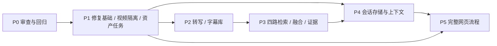

# EviReel / VideoMemory Agent V2：P1–P5 实施计划

版本：v1.4，P1–P3 已实现；后续直接在默认 main 分支开发
编写日期：2026-10-17（Asia/Shanghai）
目标仓库：[xiaohuali280-star/EviReel](https://github.com/xiaohuali280-star/EviReel)
EviReel 起始 main：`daef28828893879251309c93be20fe7fe6a00841`（包含原 VAM 基线与 P0 报告/测试）
P0 报告提交：`d5d26771a628f1d0b3565b6ade1854756f7e3d03`
历史 P0 草稿：[原 VAM PR #1](https://github.com/xiaohuali280-star/VAM/pull/1)；EviReel 已导入 P0 内容，无需等待原仓库合并。

**当前授权：唯一开发仓库为 EviReel。用户已授权完成并上传 P3，所有修改直接在默认 main 分支进行，不再新建开发分支或 PR。P1–P3 的实际交付分别见 docs/P1_DELIVERY.md、docs/P2_DELIVERY.md、docs/P3_DELIVERY.md；P4/P5 仍为计划，需按用户后续阶段指令实施。分支流程以 AGENTS.md 为准。**

P1–P3 的实际实现与验证以阶段交付报告为准；P4/P5 仍为拟议设计。实际编码前须再次检查仓库变化；已有函数以固定提交源码和 P0 报告为依据。

## 1. 最终目标与阶段边界

完成 P5 后，用户能在网页上传课程视频，等待视觉和字幕索引，播放原视频，提出涉及语音与画面的连续问题，查看答案对应的字幕、事件和关键帧，点击时间戳跳转，并在断线或重开网页后恢复会话。

| 阶段 | 要解决的问题 | 可交付结果 | 本阶段不提前实现 |
| --- | --- | --- | --- |
| P1 视频管理与持久化 | 原视频被删除、默认库混视频、任务状态重启丢失 | 视频资产、独立记忆库、持久任务、播放与删除、显式 video_id | ASR、RRF、持久会话、网页 |
| P2 ASR 与字幕记忆 | 只看画面，找不到教师口述内容 | 带时间戳的字幕、Chunk、文本向量和字幕检索 | 四路融合、会话压缩、网页 |
| P3 多模态 Hybrid RAG | 多来源结果缺少统一排序和证据协议 | Frame/Event/Summary/Transcript 召回、RRF、可选 Rerank、可溯源回答 | 持久化连续会话、完整网页 |
| P4 会话记忆 | 顶层路由不看历史、断线丢失、指代不完整 | SQLite 会话、上下文预算、摘要压缩、证据锚点与重连恢复 | 用户账号系统、无限历史 Prompt |
| P5 React 前端 | 用户无法通过网页完成完整流程 | 视频管理、播放器、字幕/事件时间轴、聊天、证据跳转与会话恢复 | 复杂视觉设计、分布式并发平台 |

P6 的完整消融实验、集中性能评估和部署完善不包含在本次实施范围；必要的测试、日志、配置与文档要随 P1–P5 各阶段完成。

## 2. 已验证基线与必须优先处理的问题

源码已存在 FFmpeg 抽帧、FrameStore/SQLite、图文 Embedding 适配器、事件切分、按需 Summary、Planner/Search/Inspect/Answer 和 WebSocket 执行事件。网页前端、ASR、多视频业务管理和持久会话尚不存在。

[最终 P0 云端测试](https://github.com/xiaohuali280-star/VAM/actions/runs/38916868722)实际执行 15 项：10 通过、2 失败、3 错误。没有真实付费模型或课程数据效果验证。

| P0 发现 | 影响 | 安排 |
| --- | --- | --- |
| frame_store.py 缺失 re 导入 | Event/Summary 文本处理报 NameError，3 项测试报错 | P1 首个修复提交 |
| 单条 Embedding 接口直接返回批量矩阵 | add_frame 获得二维向量并记录错误维度 | P1 修复并覆盖单文本、单图片和批量协议 |
| retention 仅改 memory_tier 时不持久化 | 重载后仍保留旧 mid/long 标签 | P1 修复；明确事件代表帧标记与时间层级的职责 |
| 默认帧编号重复且 Agent 解析默认库 | 不同视频可能跳过同名帧、混用内容或查错库 | P1 全链路 video_id 隔离 |
| 模型身份与输入用途校验不足 | 相同维度但不同模型的向量可能混用；建库文本也可能使用 query 输入用途 | P1 固化模型指纹；P2 明确 document/query |
| WS history 每连接新建，顶层 route_text_request 不收历史 | 连续追问和断线恢复不完整 | P4 接通顶层与内部 Planner |

**P1 准入条件（已核实）：**EviReel 起始 main 已包含 P0 报告、CI 和测试。实施前以 EviReel 的真实源码重新核对，P1 不依赖原 VAM 仓库 PR 合并。

P0 的 retention 测试曾临时注入标准库 re，以隔离另一缺陷。P1 修复后移除此诊断性注入，用真实生产路径验证，不能靠保留补丁宣称修复成功。

## 3. 共用架构与约束

### 3.1 复用优先

- 后端继续 FastAPI、HTTP 和 WebSocket，保留现有 rich TUI 调试入口。
- 复用 FrameStore、FFmpeg 抽帧、去重、事件生成和 Agentic Retrieval，不另起一套 Agent 框架。
- 前端采用 React + TypeScript + Vite；当前仓库没有需要迁移的现成网页。
- SQLite 保存业务元数据、任务、字幕和会话；视觉记忆继续复用 FrameStore 的 SQLite。
- 不新增 MySQL、Redis、Celery、LangChain、LangGraph 或多 Agent 框架。
- MVP 后端采用单服务进程、单 Uvicorn worker、有界后台任务。任务记录持久化不代表执行器已分布式化。

### 3.2 视频隔离与数据生命周期

建议逻辑布局：

```text
DATA_ROOT/
  registry.sqlite3                 # 视频、任务；P4 再迁移新增会话表
  videos/<server-generated-id>/
    source.<validated-extension>   # 上传的原视频
    playback.mp4                   # 仅在需要转码时生成
    memory/<generation>.sqlite3    # 独立 FrameStore；服务端维护活跃版本
    cache/                         # 受控帧缓存、事件片段等
    audio/                         # P2 按需生成，可清理
```

目录布局可在编码时微调，但下列规则固定：

1. 路径由服务器生成与解析，浏览器只传 video_id，不传服务器文件路径。
2. 所有 Frame/Event/Summary/Transcript、检索与聊天请求都有明确的视频归属。
3. 视频知识、用户会话和本轮 Agent 执行上下文使用独立结构；删除和重建策略分别定义。
4. 重建先写新的索引版本，成功后切换活跃版本；失败保留旧可用版本。SQLite WAL/SHM 不能作为普通单文件随意移动覆盖。
5. 查询固定本次使用的索引版本；切换、删除与缓存回收协调，避免正在查询时移除数据库。
6. 原视频不因索引失败而删除；上传验证失败的临时文件则必须清理。

### 3.3 时间与记忆语义

- 对播放器、字幕和证据统一使用视频相对秒数；absolute_t 作为可选附加字段保留。
- start_t/end_t 必须有限、非负、顺序正确，并符合已知视频时长；帧证据允许 start_t=end_t。
- Recent/Mid/Long 仍按视频时间轴的年龄采样与压缩，不按上传时间。
- Frame/Event/Summary 是语义粒度；Transcript 为独立来源，不归入时间层级。
- Summary 默认保持按需生成。P5 展示已有事件与摘要，不虚构“上传自动章节”；自动章节不属于本计划默认范围。

### 3.4 模型与测试边界

- Embedding 和回答模型是不同职责；配置应允许分别指定服务、模型、端点和密钥，并保留现有配置回退。
- 向量库记录 provider、model、实际 dimension 和必要的编码/输入用途版本，不保存密钥。
- 单条/批量响应校验数量、维度和有限数值；图文共用向量空间必须由实际服务能力保证。
- Mock 使用确定性非零向量验证排序与协议，不能把全零 DummyBackend 当作质量评估。
- 无密钥时默认禁用真实模型集成测试并明确标记；不能因 Mock 通过就宣称真实问答正确。
- 每阶段分别汇报“代码已实现”“自动测试通过”“真实 API 已验证”。

## 4. P1：视频管理与持久化

### 4.1 完成目标

两个视频能独立上传、保存、索引、查询与播放；相同文件名或帧编号不影响彼此。服务重启后视频与任务记录仍在，失败能解释并重试。

### 4.2 实施顺序和具体改动

**P1-A：恢复可用基础能力。**

修复缺失导入、单条向量返回协议和层级持久化；补齐回归测试。事件代表帧的保留依据应与按年龄计算的 memory_tier 分离，优先使用独立属性/规则表达，必要时迁移旧库，避免反复依赖 long 标签做两件事。模型指纹不兼容时拒绝继续写入；旧库缺少身份信息时提示备份/重建或明确迁移，不静默认定兼容。

**P1-B：建立 VideoRegistry 与业务数据库。**

videos 至少保存 video_id、原文件名、受控原片/播放路径、大小、duration、创建时间、可用状态、活跃视觉索引版本和模型指纹。数据库采用有版本的增量迁移；本阶段仅创建实际使用的表。

**P1-C：安全上传、播放与删除。**

流式上传至暂存文件，检查体积限制与候选扩展名，再用 FFprobe 确认真实视频轨、容器和时长。文件名只用于展示；非法路径、伪装文件、超限和写盘失败均返回结构化错误并清理暂存。

验证浏览器播放兼容性；需要时生成可播放副本，保留时间轴映射，不随意改变播放速度或起点。播放接口支持 Range/206，并测试错误范围和时间跳转。删除前确认没有运行中的索引/问答占用；MVP 可对忙碌视频返回 409，避免不完整取消后强删。

**P1-D：持久任务与受控重试。**

index_jobs 至少保存 job_id、video_id、阶段、状态、进度、attempt、错误码/消息、起止时间与索引版本。统一任务状态为 queued/running/succeeded/partial/failed/interrupted；partial 必须附带哪些能力可用、哪些阶段失败。

复用 JobManager 进度通知，业务 SQLite 作为状态事实来源。进程重启把遗留 running 标记 interrupted；MVP 不自动无限重试。每视频同一类索引最多运行一个，后台并发有上限。全部 Embedding 失败不能标记成功；少量失败要明确 partial 或按阈值 failed。

**P1-E：贯穿 Agent 和只读证据接口。**

HTTP/WS 请求经 VideoRegistry 校验后，将明确的 FrameStore 传入 retrieve、summarize 和 search_generator；禁止收到 video_id 后仍回退默认库。提供分页读取帧、事件/摘要和关键帧图像的接口，供 P5 使用；普通列表不返回全部 Base64 图片。

旧 path/store_path 接口默认不对业务客户端开放；若保留兼容入口，只能通过明确的服务器内部配置启用。TUI/库级调用的兼容路径与网页业务路径分开说明。

### 4.3 文件改动清单

| 类型 | 拟改动文件 | 用途 |
| --- | --- | --- |
| 修改 | vam/retrieval/frame_store.py、vam/vision/backends.py、vam/llm/openrouter.py | 修复 P0 缺陷、模型指纹与向量协议 |
| 新增 | vam/storage/database.py、vam/storage/migrations/ | 业务 SQLite、迁移与事务边界 |
| 新增 | vam/video_registry.py、vam/indexing/service.py | 视频路径/版本解析、任务调度和生命周期 |
| 新增 | vam/server/api/videos.py、jobs.py、memory.py | 视频 CRUD、播放、任务查询、受控记忆读取 |
| 修改 | vam/video.py、vam/jobs.py | 接入持久化资产与进度，避免删除原片，缓存归入视频目录 |
| 修改 | vam/agent.py、vam/server/ws/agent_chat.py、vam/protocol.py | 显式视频上下文与错误协议 |
| 修改 | vam/server/app.py、vam/server/api/frames.py、vam/config.py | 挂载新路由，约束旧接口，新增限制配置 |
| 修改/新增 | tests/、README.md、.env.example、.github/workflows/ | 回归、接口/恢复测试和部署说明；CI 不再只监听 P0 分支 |

### 4.4 拟议 HTTP 接口

| 接口 | 行为 |
| --- | --- |
| POST /api/videos | 上传并创建视频；默认排队视觉索引，返回 video_id 和 job_id |
| GET /api/videos | 分页视频列表与能力状态 |
| GET /api/videos/{video_id} | 视频详情、处理阶段与可用能力 |
| GET /api/videos/{video_id}/content | 受控播放文件，支持 Range |
| DELETE /api/videos/{video_id} | 无占用时删除视频资产与索引 |
| POST /api/videos/{video_id}/index | 显式重建/重试；重复运行返回明确冲突 |
| GET /api/jobs/{job_id} | 持久任务状态、阶段、可用能力和错误 |
| GET /api/videos/{video_id}/frames | 分页帧时间与图像引用 |
| GET /api/videos/{video_id}/frames/{frame_id}/image | 受控关键帧图片 |
| GET /api/videos/{video_id}/memory-documents | 分页 Event/Summary 与时间范围 |

不存在的资源为 404，输入错误为 422，任务冲突为 409；上传体积超限为 413，不支持的媒体为 415，存储不足单独报告。路由名称在实施时可按现有风格小幅调整，语义不可丢失。

### 4.5 验收与阶段出口

- 原有 3 项及修复后的 P0 回归通过；不通过时说明具体阻断。
- 两个同名视频、相同起始帧编号分别索引，读取、检索、summarize 和 WS 均无跨视频数据。
- 原片保留，真实媒体 Range/206 与播放器定位验证通过。
- 服务重启后列表、播放和任务终态恢复；中断任务可重试且不污染已有索引。
- 删除 A 不影响 B；忙碌删除、非法路径、无视频轨、超限和磁盘失败有明确结果。
- Mock API 集成通过与真实模型视觉索引验证分别记录。

## 5. P2：ASR 与字幕记忆

### 5.1 完成目标

把教师语音变成可检索、可显示的带时间戳字幕，并能找到口述内容对应的视频区间。视觉与字幕处理可以分别成功或失败。

### 5.2 实施顺序和具体改动

**P2-A：音频探测与提取。**

通过 FFprobe 判断音轨，FFmpeg 提取固定采样率/声道的音频；保留与视频相对时间的偏移关系。无音轨记录 skipped/no_audio，视频视觉能力继续可用。提取超时、退出码和临时文件清理可观测。

**P2-B：可替换 Transcriber。**

实现 faster-whisper 适配器和 Mock Transcriber。MVP 支持 CPU 配置的小模型，模型大小/语言/device/compute_type 可配置；不要求 GPU。模型未安装或未下载时明确记录依赖缺失，不能伪造转写结果。faster-whisper 作为可选 ASR 依赖，测试环境避免隐式下载大模型。

**P2-C：字幕规范化与 Chunk。**

保存原始 segment 的 text、start_t、end_t、语言与适用的质量字段；不把 segment 时间冒充词级时间。Chunk 按句子边界、最大时长/文本长度及停顿合并，起止时间来自组成 segment。中英混合、标点缺失和很长句子均有确定性处理；如使用重叠窗口，保留原始 segment IDs 便于检索去重。

**P2-D：持久化与 Embedding。**

在每视频的记忆库内新增字幕相关表，通过 FrameStore/同库适配层管理；不得被现有视觉全量持久化逻辑误清空。原始 segments 与用于检索的 chunks 分开保存，Chunk 至少包含 video_id、doc_id、start_t、end_t、text、embedding、dim、模型指纹和转写版本。

建库使用 document 用途、查询使用 query 用途；与视觉复用同一兼容的图文模型时可直接使用现有 Backend。未来若切换独立文本模型，必须单独标记向量空间，只在对应通道内算相似度。

**P2-E：幂等、独立状态与基础检索。**

以原片校验值、ASR 模型/配置和 Chunk 规则版本标识一次字幕构建。重复相同任务不重复插入；重建先暂存，文本/向量完整后切换活跃字幕版本，失败不覆盖旧数据。空转写与无音轨分别报告。

视觉成功、ASR 失败时总任务可为 partial，说明 vision=ready、transcript=failed；用户仍能使用视觉检索。ASR 成功但字幕 Embedding 失败时保留可展示文本，将“字幕可读”与“字幕可语义检索”分别标记，并支持重试。

P2 提供独立 Transcript 语义查询；接入完整四路 Planner 留给 P3。

### 5.3 文件和接口

| 类型 | 拟改动文件 | 用途 |
| --- | --- | --- |
| 新增 | vam/asr/audio.py、transcriber.py、chunker.py | 音频提取、faster-whisper/Mock、字幕切块 |
| 新增 | vam/memory/transcript.py | 字幕 schema、幂等与向量查询 |
| 修改 | vam/retrieval/frame_store.py | 同库迁移/生命周期入口，不重写视觉存储 |
| 新增 | vam/server/api/transcripts.py | 分页字幕与独立字幕语义检索 |
| 修改 | vam/indexing/service.py、vam/jobs.py、vam/config.py | 编排 ASR、分阶段状态与资源限制 |
| 修改 | vam/vision/backends.py、vam/llm/openrouter.py | 明确 query/document 用途与校验 |
| 修改/新增 | pyproject.toml、setup.cfg、.env.example、tests/、README.md | 可选依赖保持一致，Mock 与小模型验证说明 |

拟新增接口：

- GET /api/videos/{video_id}/transcripts：按时间/分页读取原始字幕或 Chunk，参数明确区分。
- POST /api/videos/{video_id}/transcripts/index：独立转写/重建字幕，返回 job_id。
- POST /api/videos/{video_id}/transcripts/search：输入 query、top_k、可选时间范围，返回带 ID/时间的字幕命中。

### 5.4 验收与阶段出口

- Mock 转写验证中文、英文、空文本、长句、重叠、非法时间、无音轨和失败恢复。
- 同一视频重复索引不产生重复 Chunk；新版本失败时旧字幕仍可读取。
- 字幕查询只返回请求视频、指定时间范围内的结果。
- 通过已知文本的 Mock 向量检索核对内容/时间字段；不把它标成真实语音准确率。
- 环境允许时，用已知台词的小型音视频运行真实 FFmpeg+faster-whisper，人工核对时间误差并记录结果；条件不足则明确此项待验证。

## 6. P3：多模态 Hybrid RAG

### 6.1 完成目标

对语音和画面联合提问时，系统能选择合适来源检索，以统一证据协议返回内容和时间范围，并解释不足或冲突的证据。

### 6.2 实施顺序和具体改动

**P3-A：统一 Evidence 协议。**

以现有检索结果适配层为入口，统一 source=frame/event/summary/transcript。字段如下：

| 字段 | 约定 |
| --- | --- |
| evidence_id | 稳定引用标识，关联 video_id、source、索引版本和来源记录；同内容重新编号不能误指旧证据 |
| video_id / index_version | 视频归属及实际来源版本；视觉/字幕可分别记录版本 |
| source | frame、event、summary、transcript 枚举 |
| doc_id / frame_id | 可空，但必须至少能定位到真实来源记录；不能凭模型生成 |
| start_t / end_t | 视频相对秒数；帧为同一点，文档/字幕为区间 |
| text | 字幕/描述/摘要；无描述的帧允许空字符串 |
| image_url / related_frame_ids | 可选，指向受控视频资源 |
| score | 本次最终排序分数，仅用于当前策略内排序，不当作概率 |
| score_details | 分来源相似度、排名、RRF、可选 Rerank 等审计信息 |

最终回答返回 answer、evidence[]、warnings 和需要的执行信息；引用必须指向本次真实返回的 evidence_id，不能只依赖丢失来源 ID 的旧 best 摘要。

**P3-B：四路召回与来源选择。**

扩展 hybrid_event_frame_search 和 Planner sources，包括协议中所有嵌套的时间锚点来源枚举。按问题选择优先粒度：口述→Transcript，PPT/公式→Frame+Transcript，某段发生什么→Event，概览→已有 Summary/Event。缺少 Summary 时回退现有来源，不每次检索自动调用付费摘要。

每路先执行 video_id、版本和时间过滤，再做语义召回。空通道不报伪成功；时间窗口定义统一并测试区间边界。保留现有多查询、视觉引用和时间锚点能力。

**P3-C：RRF 与去重。**

融合各通道排名，采用 `RRF(d)=Σ 1/(k+rank_i(d))`，rank 从 1 开始；k 默认建议 60，可配置。保留原相似度作诊断，不直接把不同来源原分数相加。多查询产生的同一记录合并；跨来源同时间段只是建立关联，不能把字幕与画面相互覆盖，避免丢失互补证据。

支持切回原有融合策略，以便后续比较；基线明确只取 Frame+Event，不能误把默认三路召回作为原论文 Baseline。

**P3-D：可配置 Rerank。**

定义 Reranker 接口，默认关闭，实现一个实际可调用、格式已核实的服务适配器及 Mock。具体服务在编码时核对官方接口和可用配置，不能写无功能占位。

优先对有文本的字幕/Event/Summary，以及已有可用描述的帧候选排序；不把空文本帧当作已完成视觉 Rerank。未覆盖的帧保留融合排序并明确策略。设置候选数/超时上限；失败回退 RRF 并返回警告，记录开关、模型、调用耗时，便于独立评估。

**P3-E：联合证据检查与回答。**

依据时间重叠/邻近，从字幕命中关联 Frame/Event；复用 inspect_frames 做视觉检查，结合字幕回答，保留证据来源与时间。不能把 VLM inspect 当成已经实现 Reranker。

检索为空、关键帧已淘汰、字幕识别疑似错误或语音/画面冲突时，应说明范围与不确定性。答案引用的时间与 ID 由程序验证；这只能防止无效引用，不能保证语义正确，仍需真实数据检查。

### 6.3 文件和接口

| 类型 | 拟改动文件 | 用途 |
| --- | --- | --- |
| 新增 | vam/retrieval/evidence.py、fusion.py、rerank.py | Evidence 适配、RRF 与 Rerank |
| 修改 | vam/retrieval/agent_search.py | 四路召回、来源选择、排序、证据检查与最终结构 |
| 修改 | vam/retrieval/frame_store.py、vam/memory/transcript.py | 复用既有查询，补充时间/来源定位 |
| 修改 | vam/protocol.py、vam/prompts.py | Transcript 枚举、工具结果与引用要求 |
| 修改 | vam/agent.py、vam/config.py | 回答包装、策略开关和诊断 |
| 新增 | vam/server/api/search.py | 便于验证的统一检索 HTTP 入口 |
| 修改/新增 | tests/、README.md、.env.example | 融合、证据、回退测试与配置文档 |

POST /api/videos/{video_id}/search 输入 query、sources、top_k、时间范围、融合策略和可选 rerank 开关；返回统一 evidence[]。WebSocket final 采用同一证据协议。客户端不能通过请求指定任意服务端 API 端点或密钥。

### 6.4 验收与阶段出口

- RRF 可手算样例、不同原分数量纲、重复记录、空来源与确定性排序测试通过。
- 来源选择、嵌套时间锚点、维度/模型不兼容和跨视频过滤测试通过。
- Rerank 开关、超时、失败回退和无文本帧策略有可观察结果。
- 最终所有引用 ID 都来自本视频的本轮检索，时间合法；不凭模型输出创建资源链接。
- Mock 验证“教师口述概念+对应 PPT”组合证据路径；真实课程/API 验证单独报告。
- 保留原视觉检索行为的必要回归，不因新增字幕破坏原 Planner 工具。

## 7. P4：会话记忆与上下文管理

### 7.1 完成目标

用户先问“注意力公式在哪里”，再问“这个公式后面有代码实现吗”，系统能结合上一轮证据理解追问；断线或重启后能恢复历史，并控制 Prompt 长度。

### 7.2 实施顺序和具体改动

**P4-A：持久会话和消息。**

业务库新增 conversations、messages 和必要的 request 状态记录。conversation_id 永久绑定一个 video_id，切换视频应选取该视频的会话或新建会话，禁止把 A 的证据带到 B。

消息保存原始问题、用于检索的改写问题、回答、引用证据快照、来源 ID/版本、时间范围、请求状态和时间。保存引用快照后，索引重建使 ID 失效时仍可展示历史，并标记“旧版本证据”；不得误解析为新记录。

**P4-B：Context Manager。**

组装“会话摘要+最近 N 轮+上一轮关键证据/时间”供顶层路由与内部 Planner 共用。N 按完整 user/assistant 轮次计数，默认建议 6 轮，可配置；同时设最大字符/估算 token 预算和单条消息长度，N 不替代预算。

较早已完成对话由 LLM 生成摘要，记录压缩到哪条消息，防止重复摘要和丢失新消息。摘要失败时保留原始数据库消息，临时缩小 Prompt 窗口并说明降级；不删除历史、不无限重试。数据库历史可增长，进入 Prompt 的内容必须有界。

**P4-C：指代解析与顶层接线。**

修改 route_text_request 接收上下文；在选择 retrieve/summarize 之前解析“这个公式”“上一段”等，保留原问题和结构化改写结果。内部 Planner 也收到相同上下文摘要与证据锚点。

“后面”以最后相关证据范围为候选时间锚点，不把上一轮检索窗口永久当硬限制；应允许必要的窗口扩展。证据不足或多个对象同样可能时请求澄清，不能硬猜。现有 session_memory.py 可借鉴摘要逻辑，用户习惯提取不进入课程问答 MVP。

**P4-D：请求幂等与断线恢复。**

每个问题使用 request_id，数据库保证同会话同请求不会重复保存用户消息/最终回答；相同 ID 配不同文本返回冲突。同一会话串行执行或明确拒绝并发，保证历史顺序。

建议受限后台任务持有问答执行，WebSocket 只负责接收/推送；断线后允许已接受的请求在超时预算内完成并落库。重连通过会话/请求状态读取结果，不要求重放每一条中间事件。服务进程重启时未完成请求标记 interrupted，用户可发新 request_id 重试；不声称模型执行能从任意步骤恢复。

最终回答和引用先提交数据库，再发送 final；断线发生在发送前也不会丢失已完成结果。普通失败保留错误状态，不把半段文本保存为正常最终答案。

### 7.3 拟议协议和接口

HTTP：

- POST /api/conversations：输入 video_id，创建会话。
- GET /api/conversations?video_id=...：列表。
- GET /api/conversations/{conversation_id}：详情、所属视频与摘要状态。
- GET /api/conversations/{conversation_id}/messages：分页消息和引用。
- GET /api/conversations/{conversation_id}/requests/{request_id}：恢复请求状态/最终结果。
- DELETE /api/conversations/{conversation_id}：无运行中请求时删除该会话。

WebSocket 新请求：

```json
{
  "type": "text",
  "video_id": "v_...",
  "conversation_id": "c_...",
  "request_id": "r_...",
  "text": "这个公式后面有代码实现吗？"
}
```

服务端事件带协议版本、video_id、conversation_id、request_id；保留可用的 plan/search/inspection 等执行阶段，增加 accepted 和明确的终态 final/error。ping/pong 为连接事件，可不带请求上下文。P5 至少展示阶段流式状态；逐 token 回答不作为本轮默认硬性要求，不假设现有客户端已支持 token delta。

原 reset 不能再只清内存却留下同名持久会话，应转为明确的新建会话行为；删除走 HTTP。新网页使用新协议；旧 TUI 可通过兼容适配运行，不能隐式共享其他会话。

### 7.4 文件与验收

拟新增 vam/memory/conversation.py、context_manager.py、vam/server/api/conversations.py、vam/conversation_service.py；修改 agent.py、agent_search.py、prompts.py、protocol.py、ws/agent_chat.py、业务迁移和配置。必要时让 connection_manager 仅管理连接订阅，不充当持久会话数据库。

阶段验收：

- Mock 验证顶层路由和内部 Planner 都获得历史/证据，完成公式→代码追问。
- 重连后历史与最终引用一致，A/B 视频会话不混用。
- 硬性 Prompt 预算测试通过，摘要失败仍能继续。
- 重复 request_id 不重复执行已完成请求、不重复插入消息；文本不一致返回冲突。
- 断线、最终结果落库后发送失败、重启中断、忙碌删除与索引版本变化均有测试。
- 真实模型指代理解作为独立验证，不由 Mock 结果代替。

## 8. P5：React + TypeScript + Vite 前端

### 8.1 完成目标

用户不使用命令行，也能完成上传、索引、播放、连续问答、证据跳转和会话恢复。

### 8.2 页面、组件和交互改动

| 模块 | 功能与行为 |
| --- | --- |
| 视频管理 | 列表/详情、上传、删除确认、失败重试；切换视频时加载对应会话 |
| 上传组件 | 文件选择/体积提示、上传进度、失败提示；前端检查不能替代后端验证 |
| 任务进度 | HTTP 轮询持久任务，分开显示上传、视觉、音频/字幕阶段；partial 明确指出可用能力 |
| 播放器 | HTML5 video 播放；等待 metadata 后才能 seek；限制时间到视频时长 |
| 字幕/事件时间轴 | 按时间分页加载，跟随 currentTime 高亮；无字幕、有 ASR 错误或无事件时分别展示 |
| 聊天窗口 | 发送、执行阶段、最终答案；禁止重复提交、显示请求状态；不强制暴露原始 Planner 推理文本 |
| 证据卡片 | source、时间、字幕/事件文本和按需关键帧图；点击时间戳定位播放器 |
| 会话管理 | 当前视频历史会话、新建、恢复；保留有效的 video/conversation 路由状态 |
| 错误与恢复 | 网络断开、模型失败、资源不存在、字幕不可用和旧证据失效有明确反馈 |

### 8.3 前端结构和数据流

建议新增 frontend/：

```text
frontend/
  package.json / package-lock.json
  vite.config.ts / tsconfig*.json
  src/
    api/                 # HTTP 类型与错误处理
    hooks/               # 任务轮询、WS、会话恢复
    components/          # Upload、Player、Timeline、Chat、Evidence
    pages/               # 视频管理与视频学习页
    types/               # 与后端协议同步的类型
    App.tsx / main.tsx
```

- HTTP 处理上传、任务、视频资源和历史；WebSocket 处理问答执行事件。
- 通过服务端明确的 Evidence/消息协议建立 TypeScript 类型；不依赖从展示文本中解析时间。
- 切换视频/会话时取消旧 HTTP 请求、关闭或重新绑定 WS，并过滤迟到事件；迟到结果不能写进新聊天。
- 重连采用有上限退避，先通过 HTTP 恢复历史和在途 request，再继续订阅；不盲目重发同一问题。
- 通过 request_id 合并恢复消息与 final，避免双条回答。
- 前端展示 Markdown 时禁用不可信 HTML，资源 URL 只使用受控路由；API Key 始终留后端。
- 长字幕与聊天分页/按需加载，图片懒加载，不一次请求完整长视频帧库。
- 开发环境用 Vite proxy 统一 HTTP/WS；生产优先同源静态资源与 FastAPI，明确路由回退和资源路径。跨域仅允许显式配置的来源。

### 8.4 后端配套改动

配置、server/app.py 和部署文档增加静态产物服务/开发代理说明；如 P1–P4 协议存在阻碍 UI 的缺口，只做必要接口补充并回归测试，不让前端绕过 video_id/路径限制。

提供不依赖付费模型的浏览器测试模式：仅测试配置下注入 Mock 服务，不把 Demo 模式默认用于生产。

### 8.5 验收与阶段出口

- TypeScript 类型检查、生产构建通过。
- 自动浏览器测试覆盖上传→任务完成→播放→提问→阶段事件→引用跳转→追问→重连恢复。
- 测试切换视频/会话后迟到事件被丢弃，证据跳转不串视频。
- 无音轨、ASR 失败但视觉可用、模型错误、断网、删除与重建后的旧引用均可解释。
- 用真实媒体验证 Range 播放与 seek；使用 Mock Agent 的浏览器流程只称为 Mock 端到端验证。
- 有条件时以真实课程/真实 API 完成人工验收，记录未完成项，不伪造结果。

## 9. 跨阶段接口、迁移和验收安排

### 9.1 实际依赖顺序



P4 的会话表可基于 P1 设计，但完整追问验收依赖 P3 稳定的证据 ID 与时间结构。P5 的页面结构可以在计划中定义，正式实现仍按阶段授权顺序执行。

### 9.2 数据归属与清理

| 数据 | 持久性 | 重建/删除规则 |
| --- | --- | --- |
| 原视频/播放副本 | 持久 | 索引失败不删除；删除视频时清理 |
| Frame/Event/Summary | 持久、每视频隔离 | 新版本成功才切换；回收旧版本须考虑在途查询 |
| Transcript/向量 | 持久、每视频与转写版本隔离 | 重试幂等，旧可用版本不被失败覆盖 |
| 会话/消息/证据快照 | 持久、绑定一个视频 | 删除会话仅影响会话；删除视频时清理其会话 |
| Agent 执行上下文 | 本轮临时 | 终态保存必要结果/诊断，不写回视频知识 |
| FFmpeg/音频临时缓存 | 可回收 | 成功/失败/删除后按策略清理，不能跨视频共用 |

### 9.3 每阶段测试与报告

每阶段至少提供源码差异、必要回归、接口/迁移测试和实际命令结果。云端先检查 Python、FFmpeg、Node、系统库、可选 ASR 模型；不能依赖用户 Windows/CUDA。保持 Windows + PyCharm 可部署的路径/配置设计。

阶段报告固定包含：目标、修改文件、核心流程、实际测试、未解决问题、分支/Commit/PR、下一阶段计划。阶段有失败时明确阻断还是可选集成未验证，不将跳过算通过。

结构化日志逐步包含 video_id、job_id、conversation_id、request_id、phase、duration 和 error_code；不记录 API Key，不默认记录完整视频/Base64 或无界 Prompt。真实模型 token/cost 指标只在服务实际提供数据时记录。

## 10. GitHub 提交与审查流程

### 10.1 默认 main 分支

所有计划、代码、配置和交付文档均直接提交至 EviReel 的默认 main 分支。开始修改前检查 main 的远程最新提交和本地工作状态，保留用户及其他协作者的改动；上传采用正常提交，禁止通过强制推送覆盖历史。

不再为阶段、计划或修复新建分支或 PR，除非用户明确更改这一要求。原计划 PR #1 与 P1 PR #2 仅作为历史记录；本次将已有计划和 P1 实现整合到 main。仓库 AGENTS.md 保存此开发约定。

### 10.2 后续实施阶段

继续按阶段授权、实施、验证并生成交付报告，以提交记录区分各阶段。P1–P3 已实施；不会自动启动 P4/P5。用户明确要求先审查再上传的阶段，先完成可审查内容并等待批准；已获授权上传的内容直接提交至 main。

没有 Cloud shell 时可使用独立工作副本、GitHub 连接器与 Actions，必须如实记录实际执行位置和测试结果。上传后确认 main 上的文件与验证版本一致，检查对应的自动测试结果。

## 11. 审查重点与默认方案

下列是本计划建议，尚不是已实现功能。审查时可重点确认：

| 决策 | 建议默认方案 | 理由与影响 |
| --- | --- | --- |
| 多视频存储 | 业务 registry + 每视频 FrameStore | 复用现有存储，隔离清晰，减少全表增加 video_id 的侵入 |
| 索引重试 | 有界单进程任务 + 持久状态 + 新版本切换 | 不引入队列系统，失败可解释，保留旧可用结果 |
| Summary | 按需生成 | 符合现有代码，控制上传时延与 API 调用 |
| ASR | faster-whisper 可选依赖、CPU 小模型配置 | 不依赖 GPU，真实效果仍需样本验证 |
| Rerank | 默认关闭，一个实际服务适配器，可回退 RRF | 独立评估成本/收益，不阻断基本检索 |
| 会话范围 | 一会话绑定一视频 | 避免指代/历史跨视频污染 |
| 上下文 | 最近 6 完整轮次建议值 + 硬预算 + 较早摘要 | 避免仅靠消息数导致 Prompt 无限膨胀 |
| WS 流式 | 先保证执行阶段事件与最终答案 | 当前没有逐 token 能力，前端可完整交互 |
| 用户账号/权限 | 不做注册登录；业务资源路径受控 | 保持原 MVP 范围，后续需要再单独立项 |
| 本轮操作 | 完成 P3 并直接上传 main | 遵守用户最新分支要求，P4/P5 继续按阶段授权 |

完成 P5 的判断以真实可操作流程、数据隔离、引用可追溯和恢复能力为准；真实模型质量与 P6 消融结果另行记录。
